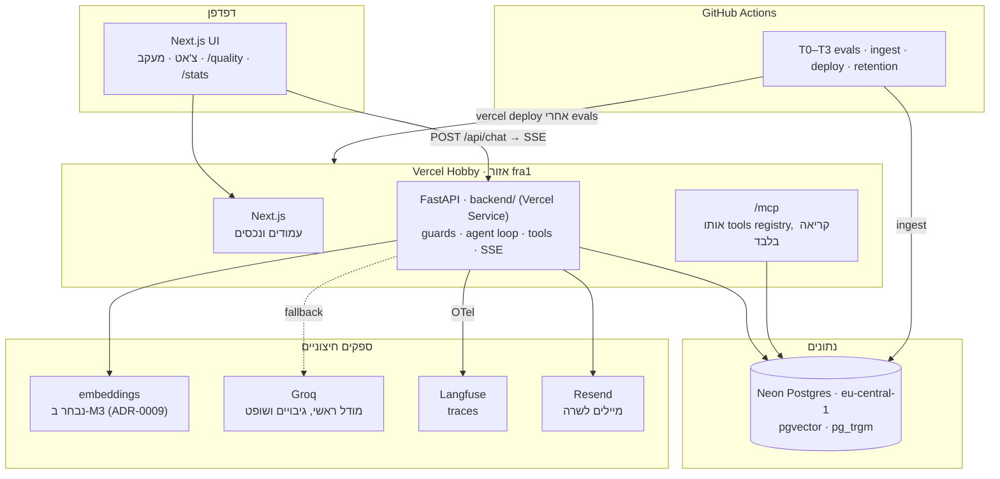
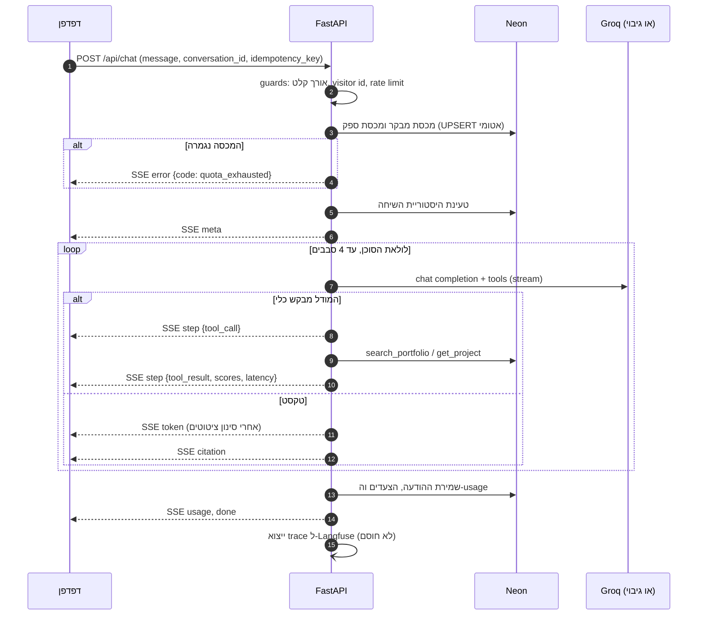

# פרק 6: ארכיטקטורה

| | |
|---|---|
| **סטטוס** | מאושר |
| **גרסה** | 1.2 |
| **תאריך** | 2026-11-03 |
| **בעלים** | שרה הלוי |
| **נשען על** | פרקים 1 עד 5 |
| **פרק הבא** | `06-agent-design.md` |

---

## 1. תמונה כללית



**שלושה עקרונות מבניים:**
1. **שירות אחד שמחליט.** כל הלוגיקה, מההגנות ועד הסוכן, נמצאת ב-FastAPI. הממשק מציג בלבד, ואין לו מפתחות.
2. **מסד אחד.** Neon מחזיק את בסיס הידע, השיחות, המכסות והמטמון. אין Redis ואין שירות חיפוש, כי בגודל הזה אין להם הצדקה.
3. **מקור אמת אחד לכלים.** הסוכן ו-`/mcp` משתמשים באותו registry. כלי מוגדר פעם אחת, נבדק פעם אחת.

## 2. רכיבים

| רכיב | אחריות | טכנולוגיה |
|---|---|---|
| **Web** | עמודים, צ'אט, חלון מעקב, עמודי שקיפות | Next.js (App Router), TypeScript, Tailwind |
| **API** | הגנות, לולאת הסוכן, כלים, הזרמה, שליחת מיילים | Python 3.12, FastAPI, Pydantic v2 |
| **Tools registry** | הגדרה אחת לכל כלי: סכמה, הרשאה, מימוש | מודול Python עם decorators |
| **Providers** | לקוח אחד תואם OpenAI, וניתוב בין ספקים | `httpx` אסינכרוני |
| **Retrieval** | חיפוש לפי התצורה שתיבחר בפרק 5 | SQL ב-Postgres |
| **MCP** | חשיפת הכלים לסוכנים חיצוניים | FastMCP, streamable HTTP, stateless |
| **DB** | בסיס ידע, שיחות, מכסות, מטמון, קישורי חברות | Neon Postgres, `psycopg` 3 דרך ה-pooler של Neon |
| **Observability** | traces, טוקנים, זמנים | OpenTelemetry → Langfuse |
| **CI/CD** | בדיקות, קליטה, פריסה, מחיקה יומית | GitHub Actions, Vercel CLI |

## 3. פריסה

**התצורה המועדפת:** פרויקט Vercel אחד עם [Vercel Services](https://vercel.com/docs/services) (Beta, זמין גם ב-Hobby). `vercel.json` בשורש מגדיר שני שירותים: `web` מ-`apps/web/` ו-`api` מ-`backend/`. כל `/api/*` מופנה ל-`api`, והוא מקבל את הנתיב המקורי, כמו `/api/health`. כל השאר הולך ל-`web`. כך אין קובץ גישור, ולכל צד יש תיקייה ותלויות משלו. (שינוי ב-M1: התכנון המקורי היה `api/index.py` בשורש.)

**חלופה, אם Services ייכשל ב-S1 או ייצא מ-Beta לתשלום:** שני פרויקטי Vercel חינמיים, `web` ו-`api`, עם CORS שמאשר רק את הדומיין של `web`.

**אזורים:** הפונקציות ב-`fra1` (פרנקפורט), ו-Neon ב-`eu-central-1`. זה הצירוף הקרוב ביותר לישראל, וגם השרת והמסד נמצאים באותו אזור, כך שכל שאילתה למסד חוסכת עשרות מילישניות.

**Cold start הוא הסיכון הגדול ליעד ה-TTFT.** פונקציית Python קרה יכולה להוסיף 1 עד 2 שניות, וזה כל התקציב. מה עושים:
- מודדים את ה-cold start כבר בניסוי של M1, לפני שבונים עליו.
- תלויות מינימליות, וייבוא עצל של ספריות כבדות.
- Fluid compute של Vercel, שמשתמש מחדש במופעים חמים.
- אם זה עדיין לא מספיק, מדווחים בדשבורד את TTFT בנפרד לבקשה חמה ולבקשה קרה, ומתעדים ב-ADR. הצגה כנה עדיפה על הסתרה.

## 4. זרימת בקשה



### אכיפת ציטוטים בזמן הזרמה
הבעיה: אם הטוקנים יוצאים ישר לדפדפן, ציטוט לא תקין כבר מוצג לפני שהשרת בודק אותו.

הפתרון: המודל מסמן ציטוט בתבנית `[[chunk_id]]`. השרת מחזיק את הטקסט בחוצץ קטן רק מרגע שמתחיל `[[` ועד `]]`, ובודק את המזהה מול הקטעים שנשלפו בשיחה.
- **מזהה תקין:** נשלח אירוע `citation`, והממשק מציג מספר מקור.
- **מזהה לא תקין:** הסימון נמחק, ונרשם אירוע `citation_dropped` ב-Langfuse.

כך האכיפה מתבצעת בזמן ההזרמה, והעיכוב הוא רק בכמה טוקנים.

## 5. פרוטוקול ההזרמה (SSE, גרסה 1)

כל אירוע הוא JSON עם `v: 1`. הממשק מתעלם מסוגי אירועים שהוא לא מכיר, כך שאפשר להוסיף סוגים חדשים בלי לשבור לקוחות קיימים.

| אירוע | תוכן | שימוש |
|---|---|---|
| `meta` | `conversation_id`, `message_id`, `model` | פתיחת ההודעה |
| `step` | `step_id`, `kind` (`llm` / `tool_call` / `tool_result`), `status` (`start` / `end`), `name`, `args`, `summary`, `duration_ms` | חלון המעקב |
| `token` | `text` | התשובה |
| `citation` | `chunk_id`, `index` | מספר מקור בטקסט |
| `sources` | רשימת קטעים: `chunk_id`, `record_title`, `section`, `text` | פאנל המקורות |
| `card` | `kind` (`project` / `diagram` / `job_match`), `data` | כרטיסים ודוחות (פרק 8) |
| `contact_draft` | `draft_id`, `summary` | טיוטת הודעה לאישור (US-7.2) |
| `usage` | טוקנים בקלט ובפלט, `ttft_ms`, `total_ms`, `fallback` | חלון המעקב |
| `error` | `code`, `message`, `retryable` | S7 ו-S8 |
| `done` | — | סיום |

**ניתוק באמצע (US-10.5):** השרת stateless, ולכן אין המשך מאותה נקודה. הממשק שולח את ההודעה מחדש עם אותו `idempotency_key`. אם ההודעה כבר נשמרה במלואה, השרת מחזיר אותה מהמסד בלי לקרוא שוב למודל ובלי לצרוך מכסה.

## 6. חוזי API

| Endpoint | קלט | פלט | הגנות |
|---|---|---|---|
| `POST /api/chat` | `message`, `conversation_id?`, `company_slug?`, `idempotency_key` | SSE | אורך, קצב, מכסות |
| `POST /api/feedback` | `message_id`, `rating`, `comment?` | `204` | קצב, אורך |
| `POST /api/contact/send` | `draft_id`, `name`, `reply_to`, `body`, `website` (honeypot) | `202` | אישור מפורש, honeypot, מכסה יומית |
| `GET /api/company/{slug}` | — | פתיח ושאלות פתיחה, או `404` | — |
| `POST /api/visit` | `company_slug` | `204` | סינון בוטים, הגבלת התראות (US-8.3) |
| `GET /api/stats` | — | מדדים מצטברים בלבד | מטמון של 5 דקות |
| `GET /api/health` | — | מצב המסד והספקים | — |
| `/mcp` | פרוטוקול MCP | כלים לקריאה בלבד | קצב נפרד |

**זיהוי מבקר:** אין הרשמה, ולכן מבקר מזוהה בעוגייה פונקציונלית עם מזהה אקראי חתום (HMAC). בנוסף נשמר hash של כתובת ה-IP, עם salt שמתחלף כל יום, כדי לזהות ניצול לרעה בלי לשמור את הכתובת עצמה. פירוט בפרק 10.

## 7. מודל הנתונים

| טבלה | עמודות עיקריות | שמירה |
|---|---|---|
| `records` | `id`, `type`, `title`, `meta` (JSONB), `content_hash`, `commit_sha` | קבוע |
| `chunks` | `id` (`<record>#<section>`), `record_id`, `text`, `context_header`, `tsv`, `embedding vector`, `lang` | קבוע |
| `conversations` | `id`, `visitor_id`, `company_slug?`, `created_at` | 30 יום (פרק 10) |
| `messages` | `id`, `conversation_id`, `role`, `content`, `model`, `usage`, `idempotency_key` | 30 יום |
| `steps` | `message_id`, `kind`, `name`, `args`, `result_summary`, `duration_ms` | 30 יום |
| `feedback` | `message_id`, `rating`, `comment` | 30 יום |
| `quota_counters` | `scope` (`visitor` / `visitor_minute` / `ip` / `provider_tokens` / `provider_closed` / `contact` / `alert`), `key`, `day`, `count` | 7 ימים |
| `ip_salts` | `day`, `salt` (אקראי, לא נגזר מסוד) | יומיים |
| `response_cache` | `key_hash`, `response`, `expires_at` | לפי TTL |
| `company_links` | `slug`, `company`, `role`, `opening`, `starter_questions` | עד ששרה מוחקת |
| `contact_requests` | `draft_id`, `conversation_id`, `status`, `sent_at` | 30 יום |
| `daily_metrics` | `day`, `metric`, `value`, `sample_size` (נוסף בפרק 9) | קבוע, אין בה מידע אישי |

- אינדקסים: `GIN` על `tsv`, `GIN` עם `gin_trgm_ops` על `text` ועל `context_header`, ו-`HNSW` על `embedding`.
- מיגרציות מנוהלות בקבצי SQL ממוספרים, ונבדקות ב-CI על מסד ריק.

## 8. מבנה ה-repo

```
apps/web/                 Next.js
  app/                    עמודים: /, /c/[slug], /quality, /stats, /privacy, /how-it-works
  components/chat/        שיחה, הודעה, ציטוטים, משוב
  components/trace/       חלון המעקב
  lib/sse.ts              לקוח SSE עם טיפול בניתוק
backend/                  שירות ה-API ב-Vercel. התלויות ב-pyproject.toml
  portfolio_agent/
    agent/                הלולאה, ההנחיות, אכיפת ציטוטים
    tools/                registry ומימוש הכלים
    providers/            לקוח תואם OpenAI, ניתוב וגיבוי
    retrieval/            חיפוש לפי התצורה שנבחרה
    guards/               קצב, מכסות, אורך, הסתרת מידע מזהה
    mcp/                  שרת MCP מעל ה-registry
    db/                   חיבור ושאילתות
    kb_check.py           בדיקת הסכמה של בסיס הידע
    ingest.py             קליטה: חיתוך, embeddings ו-upsert. רץ ב-CI, ולכן נבדק כמו שאר הקוד
  migrations/             SQL ממוספר
  tests/                  pytest
vercel.json               שני השירותים והניתוב ביניהם
spikes/                   הניסויים של M1
portfolio/                בסיס הידע (פרק 3)
scripts/                  company_links.py (מקומי בלבד)
evals/                    D1–D4, Promptfoo, retrieval, calibration, results
docs/                     האפיון, ADRs, ניסויים
.github/workflows/        ci.yml, nightly.yml, deploy.yml, retention.yml
docker-compose.yml        Postgres עם pgvector לפיתוח מקומי
Makefile                  dev, test, eval, ingest
```

## 9. נושאים רוחביים

**תצורה וסודות.** כל המפתחות נמצאים במשתני סביבה של Vercel ו-GitHub, ואף פעם לא ב-repo. קובץ `.env.example` מתעד כל משתנה, בלי ערכים:
`GEMINI_API_KEY`, `GROQ_API_KEY`, `DATABASE_URL`, `LANGFUSE_PUBLIC_KEY`, `LANGFUSE_SECRET_KEY`, `RESEND_API_KEY`, `CONTACT_EMAIL`, `VISITOR_HMAC_SECRET`, `CANARY_TOKEN`.

**זמנים קצובים.**
| פעולה | זמן מקסימלי |
|---|---|
| קריאה לספק, עד הטוקן הראשון | 8 שניות, ואז מעבר לגיבוי |
| קריאה לספק, כוללת | 30 שניות |
| שאילתה למסד | 2 שניות |
| בקשת צ'אט שלמה | 60 שניות |

**סיווג שגיאות.** כל שגיאה מקבלת `code` קבוע (`quota_exhausted`, `rate_limited`, `input_too_long`, `provider_unavailable`, `internal`) ודגל `retryable`. הממשק בוחר מסך לפי הקוד, ולא לפי טקסט השגיאה.

**פיתוח מקומי.** `make dev` מרים Postgres ב-Docker, מריץ מיגרציות וקליטה, ומפעיל את שני השרתים. מהנדס שבודק את הפרויקט צריך רק מפתחות חינמיים משלו (US-9.6).

## 10. החלטות שיתועדו כ-ADR

| ADR | החלטה |
|---|---|
| 0001 | לולאת סוכן עצמית במקום framework. **נכתב** (`adr/0001-own-agent-loop.md`) |
| 0002 | סוכן אחד עם כלים, בלי multi-agent. **נכתב** (`adr/0002-single-agent.md`) |
| 0003 | Neon כמסד יחיד, בלי Redis ובלי שירות חיפוש |
| 0004 | Python ו-FastAPI ב-Vercel לצד Next.js, דרך Vercel Services. **נכתב** (`adr/0004-vercel-services.md`) |
| 0005 | לקוח אחד תואם OpenAI לכל הספקים, Groq ראשי. **נכתב** (`adr/0005-llm-providers.md`) |
| 0006 | אכיפת ציטוטים בזמן הזרמה. **נכתב** (`adr/0006-streaming-citation-enforcement.md`) |
| 0007 | registry אחד לכלים, והרצה בתוך התהליך במקום דרך MCP. **נכתב** (`adr/0007-tool-registry-in-process.md`) |
| 0008 | פריסה דרך GitHub Actions אחרי evals, ולא פריסה אוטומטית |
| 0009 | בלי Gemini חינמי בנתיב של המבקרים. embeddings נבחר ב-M3, ואין מודל חירום מחוץ ל-Groq. **נכתב** (`adr/0009-no-free-gemini-in-production.md`) |
| 0010 ואילך | החלטות השליפה מ-M3 (פרק 5, סעיף 9) |

## 11. החלטות

| נושא | מצב |
|---|---|
| עיצוב | **הוחלט:** העיצוב נבנה בנפרד ב-Claude Design, לפני M5. מהעיצוב המאושר מחלצים design tokens (צבעים, גופנים, מרווחים, רדיוסים) לתצורת Tailwind, ומשם הם משמשים את כל רכיבי `apps/web`. אין צבעים או גדלים קבועים בתוך הרכיבים |
| ספקים נוספים | **הוחלט:** מותר להוסיף ספק חינמי נוסף, כמו Hugging Face, אם רק אצלו יש מודל מתאים, ובתנאי שאין אמצעי תשלום. כל ספק כזה מקבל ADR |
