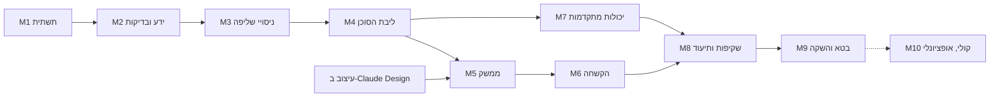

# פרק 12: מפת דרכים

| | |
|---|---|
| **סטטוס** | מאושר. השאלות בסעיף 7 נדחו ל-M8 ול-M9 |
| **גרסה** | 1.0 |
| **תאריך** | 2026-11-03 |
| **בעלים** | שרה הלוי |
| **נשען על** | פרקים 1 עד 11 |

---

## 1. איך עובדים

- **אין תאריכים. יש קריטריוני יציאה.** אבן דרך מסתיימת רק כשכל הקריטריונים שלה מתקיימים (פרק 1: "מרשים, לא מהיר").
- **כל אבן דרך מתחילה בתוכנית קצרה ומסתיימת בהדגמה לשרה.** כמו בפרקי האפיון: מציגים, שרה מאשרת, ורק אז ממשיכים.
- **סדר העבודה נקבע לפי תלויות**, ולא לפי מה שמרשים להראות קודם. הבדיקות נבנות לפני השליפה, והשליפה לפני הסוכן.
- **שינוי באפיון אחרי שאושר** נעשה כ-commit שמעדכן את הגרסה בכותרת הפרק. החלטה חדשה מקבלת ADR.

### הגדרת "סיום" לכל משימה
1. הקוד נכתב, ויש לו בדיקות.
2. ה-CI ירוק, כולל שכבות הבדיקה שרלוונטיות למשימה (פרק 4, סעיף 7).
3. אם התקבלה החלטה, יש ADR. אם האפיון השתנה, הוא עודכן.
4. אם המשימה נוגעת בתשובות של הסוכן, ההשפעה שלה נראית בחלון המעקב.

## 2. תלויות

**העיצוב רץ במקביל.** אפשר להתחיל אותו ב-Claude Design כבר בזמן M2, כי הוא תלוי רק בפרקים 2 ו-9 (המסכים והשקיפות). הוא חייב להיות מאושר לפני M5.

## 3. אבני הדרך

### M1: תשתית וניסויים

**שרה:**
- פתיחת חשבונות: GitHub, Vercel, Neon, Langfuse.
- Google AI Studio: שני פרויקטים, אחד לפרודקשן ואחד לבדיקות. מפתח לכל אחד.
- Groq: שני מפתחות, לפרודקשן ולבדיקות.
- Resend: חשבון עם `sarah94087@gmail.com`.
- הזנת כל המפתחות במשתני הסביבה של Vercel ו-GitHub. **אני לא מזין מפתחות.**

**ניסויים:**
| # | ניסוי | שאלה |
|---|---|---|
| S1 | Next.js ו-FastAPI באותו פרויקט Vercel, עם SSE | האם התצורה המועדפת מפרק 6 עובדת, כולל הזרמה? |
| S2 | cold start של הפונקציה ושל Neon | כמה זמן מוסיפה בקשה קרה, והאם יעד ה-TTFT ריאלי? |
| S3 | Gemini ו-Groq: 20 שאלות בעברית עם קריאות לכלים | האם שני המודלים מפעילים כלים נכון, ועונים בעברית טובה? |
| S4 | embeddings ו-reranking חינמיים | מה זמין, מה זמן התגובה, ומה המגבלות? |
| S5 | מגבלות ותנאי שימוש | כל המספרים מפרק 11, סעיף 2, ומותר שיהיו כמה פרויקטים? |
| S6 | OpenTelemetry ל-Langfuse | trace אחד מגיע עם כל השדות? |

**קוד:** שלד ה-repo (פרק 6, סעיף 8), `docker-compose.yml`, `Makefile`, `ci.yml` עם T0, gitleaks ומיגרציות על מסד ריק.

**יציאה:**
- דוח ניסויים ב-`docs/experiments/m1-spikes.md`.
- ADR-0004 ו-ADR-0005 אושרו או שונו לפי התוצאות. **ADR-0005 שונה:** Groq ראשי. **ADR-0009 נוסף:** בלי Gemini בפרודקשן, ו-embeddings נבחר ב-M3.
- פרק 11 עודכן במספרים המאומתים.
- ה-CI ירוק על ה-repo הריק.

---

### M2: בסיס הידע וסטי הבדיקה

**שרה:**
- מעבירה את החומרים הגולמיים, רשומה אחר רשומה.
- עונה על שאלות הראיון לפרטים החסרים (פרק 3, סעיף 7).
- מאשרת כל רשומה.
- קובעת רמה לכל כישור: `used`, `studied` או `listed`.
- מתייגת את D1 ואת D3 (בערך 2 עד 3 שעות, בכמה ישיבות).

**קוד ותוכן:**
- 15 הרשומות מפרק 3, סעיף 5, ו-`skills.md` עם רמות.
- סכמת Pydantic, ובדיקת פרסום עם רשימת המונחים האסורים.
- טיוטות D1 (85 שאלות), D2, D3 ו-D4, כולל בדיקה בקוד שהשאלות מנוסחות שונה מהרשומות.
- חלוקה ל-`dev` ו-`test`.

**יציאה:** כל הרשומות מאושרות ועוברות את בדיקת הסכמה. D1 ו-D3 מתויגים ומאושרים.

---

### M3: ניסויי שליפה

**קוד:**
- `ingest.py` מלא, כולל embeddings אם S4 מצא מודל מתאים.
- R1 עד R4, C1 עד C4, ו-Q0 עד Q2 (פרק 5).
- כלי הבדיקה לשליפה, ו-`stats.py` (Wilson ו-bootstrap) עם בדיקות יחידה.
- הרצת שלבים 1 עד 5 מפרק 5, סעיף 4.

**שרה:** מאשרת את הספים הסופיים, אחרי שהיא רואה את ה-baseline (פרק 4, סעיף 6).

**יציאה:**
- דוח ניסויים ב-`docs/experiments/retrieval-<date>.md`.
- תצורה שנבחרה לפי כלל ההכרעה, ו-ADRs לכל החלטת שליפה.
- הספים הסופיים אושרו.

---

### M4: ליבת הסוכן

**קוד:**
- הלולאה, ה-registry, `search_portfolio` ו-`get_project`.
- הנתב בין הספקים, כולל מפסק הזרם.
- מסנני הזרם: ציטוטים, קנרית ומידע פרטי, עם property tests.
- SSE גרסה 1, שמירה במסד, idempotency, מטמון ו-Langfuse.
- הנחיית המערכת `system.v1.md`.
- Promptfoo ל-T1 ול-T2.

**שרה:** מתייגת 60 החלטות של השופט, לכיול (כשעה).

**יציאה:**
- ספי D1 מתקיימים על `dev`.
- kappa של השופט ≥ 0.7 בכל מדד.
- ADR-0001, 0002, 0006 ו-0007 כתובים.

---

### מסלול מקביל: עיצוב

**ב-Claude Design:** כל המסכים מפרק 2, סעיף 2, בדסקטופ ובנייד, במצב בהיר ובמצב כהה. חלון המעקב במצב מקופל ובמצב פתוח.

**יציאה:** שרה מאשרת את העיצוב, וה-design tokens מוכנים להעברה ל-Tailwind.

---

### M5: הממשק

**קוד:**
- כל המסכים, לפי העיצוב המאושר.
- לקוח SSE עם טיפול בניתוק.
- חלון מעקב מלא (פרק 9, סעיף 2).
- ציטוטים, משוב, מחיקת שיחה, RTL ו-`dir="auto"`.
- בדיקות Playwright, כולל הקלטות SSE.
- פריסה ראשונה לפרודקשן דרך `deploy.yml`.

**יציאה:**
- כל ה-stories של E1, E2, E4 ו-E11 עוברים את קריטריוני הקבלה.
- עובד ב-375px ובדסקטופ, בשני המצבים.
- axe לא מוצא הפרות, ובדיקה ידנית של WCAG 2.2 AA עברה.

---

### M6: הקשחה

**קוד:**
- כל המגבלות מפרק 10, סעיף 4, מתג הכיבוי וכותרות האבטחה.
- D2 המלא, OWASP ZAP, `pip-audit` ו-`npm audit`.
- `/privacy`, עבודת המחיקה היומית והתראות הניטור.
- `/quality`, שנבנה מקבצי התוצאות.
- סולם הירידה ההדרגתית (פרק 11, סעיף 7), כולל בדיקה מבוקרת של כל שלב.

**יציאה:**
- אפס דליפות ואפס הזרקות מוצלחות ב-D2.
- כל השערים בפרק 4 פעילים וחוסמים פריסה.

---

### M7: יכולות מתקדמות

**קוד:**
- `match_job` עם חמשת השלבים מפרק 8, הורדה כ-Markdown וכ-PDF.
- `render_card`: כרטיסים ודיאגרמות.
- קישורי חברות: הסקריפט, ההתראות וסינון הבוטים.
- יצירת קשר: מכונת המצבים, Resend ו-honeypot.

**יציאה:**
- ספי D3 מתקיימים: אפס התאמות חזקות שגויות, כיסוי פערים ≥ 0.9.
- כל ה-stories של E5 עד E8 עוברים.
- מייל קשר אמיתי אחד ומייל התראה אמיתי אחד הגיעו לשרה.

---

### M8: שקיפות ותיעוד

**קוד ותוכן:**
- `/stats` ו-`daily_metrics`, כולל סף המדגם.
- `/how-it-works`, האתגר הפתוח ורשימת המקרים.
- README עם סיפור ההחלטות ומסלול הבדיקה של 10 דקות.
- כל ה-ADRs, כל ה-runbooks ותבנית postmortem.
- הרשומה `this-agent` בבסיס הידע.

**יציאה:** **מבחן קורא חיצוני.** מהנדס שלא מכיר את הפרויקט מקבל רק את הקישור ל-repo. תוך 10 דקות הוא יודע להסביר את הארכיטקטורה, איך נבחרה שיטת השליפה ואיך מריצים את הבדיקות.

---

### M9: בטא והשקה

**שרה:** בוחרת 5 עד 10 אנשים לבטא, ושולחת להם את הקישור: מגייסת או שתיים, כמה מהנדסים בכירים, ואחד או שניים שינסו לשבור את הסוכן.

**קוד ותוכן:**
- סקירת כל המשוב ותיקונים. כל בעיה מהותית הופכת לפריט בדיקה.
- הרצה רשמית של T3, ועדכון עמוד האיכות.
- הפיכת ה-repo לציבורי.

**רשימת בדיקה להשקה:**
- [ ] כל ספי פרק 4 מתקיימים בהרצת T3.
- [ ] TTFT ב-p50 מתחת ל-2 שניות, לפי Langfuse.
- [ ] הודעת הפרטיות ועמוד `/privacy` מעודכנים.
- [ ] gitleaks על כל ההיסטוריה של ה-repo, לפני שהוא הופך לציבורי.
- [ ] אין ב-repo מידע אסור: בדיקת פרסום על כל בסיס הידע, ועוד מעבר ידני.
- [ ] מתג הכיבוי נבדק.
- [ ] שם הסוכן נקבע.

**יציאה:** כל הרשימה מסומנת, והמשוב מהבטא טופל. **ההשקה עצמה היא של שרה:** היא מחליטה מתי ולמי לשלוח את הקישור.

---

### M10: מצב קולי (אופציונלי)

ניסוי עם Pipecat: זיהוי דיבור בעברית, זמן תגובה, ועלות במכסות החינמיות.

**ממשיכים לבנייה רק אם** הזיהוי בעברית טוב והעיכוב סביר לשיחה. אחרת, כותבים ADR שמסביר למה לא, וזה גם ממצא.

## 4. מה שרה עושה, לפי אבני הדרך

| אבן דרך | משימות של שרה | זמן משוער |
|---|---|---|
| M1 | חשבונות ומפתחות | כשעה |
| M2 | חומרים, ראיון, אישור רשומות, רמות כישורים, תיוג D1 ו-D3 | הכי הרבה זמן. כמה ישיבות |
| M3 | אישור הספים הסופיים | כחצי שעה |
| M4 | תיוג לכיול השופט | כשעה |
| עיצוב | עבודה ב-Claude Design ואישור | לפי הצורך |
| M5 עד M8 | הדגמה ואישור בסוף כל אבן דרך | כחצי שעה לכל אחת |
| M9 | בחירת אנשי הבטא, ההחלטה על ההשקה | לפי הצורך |

## 5. החלטות שעדיין פתוחות

| החלטה | פרק | נדרשת עד |
|---|---|---|
| שם הסוכן | 1, 7 | M9 |
| הקהל המכריע | 1 | לא חוסם. ברירת המחדל: מוצק הנדסית לפני "נראה טוב" |
| איך הסוכן פונה למבקר בעברית | 7 | M4 (ההנחיה). עד אז ניסוח ניטרלי |
| רמות הכישורים | 3 | M2 |
| מגבלות ספקים ותנאי שימוש | 11 | M1 |

## 6. אחרי שהאפיון מאושר

1. **`docs/README.md`:** אינדקס לכל הפרקים, עם הסטטוס והגרסה של כל אחד.
2. **עמוד HTML לשיתוף:** גרסה מעוצבת של האפיון, כ-Artifact פרטי. שרה מחליטה אם ועם מי לשתף.
3. **תחילת M1:** רשימת החשבונות לשרה, ושלד ה-repo.

## 7. שאלות פתוחות לפרק הזה

1. **מבחן הקורא החיצוני ב-M8:** יש לך מהנדס בכיר שיסכים לעבור על ה-repo ל-10 דקות?
2. **אנשי הבטא ב-M9:** כבר עכשיו יש לך כיוון למי לפנות, או שנחשוב על זה כשנגיע?
