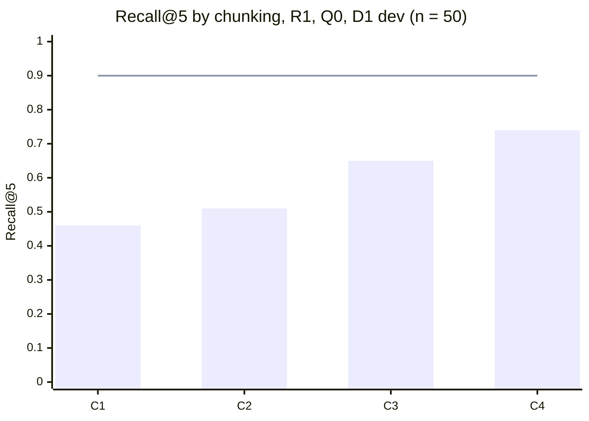

# M3: דוח ניסויי השליפה

| | |
|---|---|
| **סטטוס** | שלב 1 עם R1 הסתיים (4.11.2026). שלב 1 עם R2, ושלבים 2 עד 5, עוד לא רצו |
| **נשען על** | `docs/04-retrieval-design.md`, סעיפים 3 עד 5 ו-9, ‏`docs/03-evaluation-methodology.md`, סעיפים 3, 5 ו-6 |
| **נתונים** | D1, ‏`evals/datasets/d1.yaml` (cfcc537), רק ה-split ‏`dev`. ‏`test` לא רץ ולא נקרא |

הנתונים הגולמיים נמצאים ב-`evals/results/2026-11-04-7f1e048-*.json`. בכל קובץ יש ציון לכל שאלה, ולכן אפשר לחשב כל השוואה מחדש בלי להריץ שוב.

**לשחזור:** מתוך `evals/`, מול Postgres מקומי עם המיגרציות:

```bash
DATABASE_URL=postgresql://... ../backend/.venv/Scripts/python -m retrieval.run_stage1
```

## שלב 1: איזה חיתוך עובד הכי טוב?

### השערה
מפרק 5, סעיף 3, ציר A:
- **C1**, קטע לכל כותרת: יחידות משמעות טבעיות, וציטוטים ברורים.
- **C2**, ‏C1 עם כותרת הקשר (שם הרשומה, `aliases` ו-`tech`): אמור לשפר בעיקר עברית ושאלות `multi_hop`.
- **C3**, חלונות של כ-300 טוקנים עם חפיפה של 50: קו בסיס מקובל.
- **C4**, רשומה שלמה כקטע אחד: במאגר כל כך קטן, אולי זה פשוט מספיק.

### מה השלב הזה בודק, ומה לא
- **רק R1.** לפי פרק 5, שלב 1 רץ עם R1 ועם R2 בנפרד. ל-R2 עוד אין מודל embeddings (ADR-0009). לכן התוצאה עונה רק על השאלה "איזה חיתוך עובד הכי טוב בשליפה מילולית". כשיהיה R2, מריצים את C1 עד C4 שוב באותה פקודה, ובודקים אם המנצח משתנה.
- **50 שאלות בלבד.** 32 בעברית ו-18 באנגלית. 11 מהן `cross_lingual`, והן חלק מ-32 העבריות. רווח הסמך הכולל רחב בערך ±0.12, וב-11 שאלות ה-`cross_lingual` בערך ±0.3. הבדל קטן מזה הוא רעש.
- **R1 דטרמיניסטי,** ולכן ריצה אחת לכל תצורה מספיקה. פרק 4, סעיף 5 דורש 3 ריצות רק לרכיב לא דטרמיניסטי.
- **ה-latency נמדד על PGlite** (Postgres ב-wasm, על המחשב של שרה), ולא על Neon. המספרים טובים רק להשוואה בין התצורות, ולא כהערכה של זמן אמיתי.

### תצורות
| | |
|---|---|
| **שליפה** | R1: ‏BM25 על `tsvector` בתצורת `simple`, ו-trigram משוקלל IDF על הטקסט ועל ה-`aliases`, ממוזגים ב-RRF עם k = 60 |
| **שאילתה** | Q0: השאלה כמו שהיא |
| **מאגר** | 16 רשומות מאושרות. 40 מהקטעים הם קטעי כישורים (`skills#<slug>`), זהים בכל ארבע השיטות |
| **ניקוד** | לפי `Chunk.sections`, כלומר הסעיפים של C1 שכל קטע מכסה. כך אותו `gold_chunks` מנקד את כל השיטות |
| **השוואה** | מזווגת, שאלה מול שאלה, ‏bootstrap של 10,000 דגימות, 95% |

### תוצאות
Recall@5, ממוצע ורווח סמך bootstrap ב-95%. ‏Recall הוא שבר לכל שאלה (למשל 2 מתוך 3 קטעים), ולכן "שאלות מלאות" סופר את השאלות שכל הקטעים הנכונים שלהן נמצאו ב-5 הראשונים.

| | קטעים | כולל (50) | שאלות מלאות | עברית (32) | אנגלית (18) | ‏`cross_lingual` ‏(11) |
|---|---|---|---|---|---|---|
| **C1** | 112 | 0.46 [0.34, 0.59] | 19/50 | 0.42 [0.25, 0.58] | 0.54 [0.35, 0.73] | 0.27 [0.00, 0.55] |
| **C2** | 112 | 0.51 [0.38, 0.64] | 22/50 | 0.46 [0.30, 0.63] | 0.59 [0.41, 0.78] | 0.45 [0.18, 0.73] |
| **C3** | 68 | 0.65 [0.52, 0.76] | 29/50 | 0.67 [0.51, 0.81] | 0.61 [0.42, 0.80] | 0.64 [0.36, 0.91] |
| **C4** | 55 | **0.74 [0.63, 0.85]** | **34/50** | **0.71 [0.56, 0.85]** | **0.81 [0.64, 0.94]** | **0.73 [0.45, 1.00]** |
| **סף (פרק 4)** | | ≥ 0.90 | | ≥ 0.85 | | ≥ 0.85 |

שאר המדדים, על כל 50 השאלות:

| | Recall@3 | Recall@10 | MRR | nDCG@5 | latency ‏p50 / p95 (ms) | טוקנים ב-5 הראשונים |
|---|---|---|---|---|---|---|
| **C1** | 0.33 | 0.70 | 0.41 | 0.37 | 88 / 114 | 523 |
| **C2** | 0.33 | 0.67 | 0.37 | 0.36 | 146 / 187 | 821 |
| **C3** | 0.51 | 0.79 | 0.53 | 0.52 | 87 / 115 | 920 |
| **C4** | 0.59 | 0.83 | 0.57 | 0.59 | 77 / 114 | 1,468 |

"טוקנים" נספרים לפי הביטוי `\w+|[^\w\s]` של `ingest.py`, ולא לפי הטוקנייזר של מודל, כי עוד לא נבחר מודל.



### השוואות מזווגות
הפרש Recall@5 (השנייה פחות הראשונה), עם רווח סמך ב-95%. כוכבית מסמנת הבדל מובהק, כלומר רווח הסמך לא כולל אפס.

| | כולל | עברית | אנגלית | ‏`cross_lingual` |
|---|---|---|---|---|
| C2 − C1 | +0.05 [−0.03, +0.14] | +0.05 [−0.08, +0.19] | +0.06 [0.00, +0.17] | +0.18 [−0.18, +0.55] |
| C3 − C1 | **+0.19 [+0.09, +0.30]\*** | **+0.25 [+0.11, +0.41]\*** | +0.07 [0.00, +0.16] | **+0.36 [+0.09, +0.64]\*** |
| C4 − C1 | **+0.28 [+0.16, +0.41]\*** | **+0.29 [+0.14, +0.46]\*** | **+0.27 [+0.10, +0.45]\*** | **+0.45 [+0.18, +0.73]\*** |
| C3 − C2 | **+0.14 [+0.03, +0.25]\*** | **+0.20 [+0.08, +0.36]\*** | +0.02 [−0.14, +0.14] | +0.18 [0.00, +0.45] |
| C4 − C2 | **+0.23 [+0.11, +0.36]\*** | **+0.24 [+0.10, +0.40]\*** | +0.21 [−0.01, +0.44] | +0.27 [0.00, +0.55] |
| C4 − C3 | **+0.10 [+0.03, +0.18]\*** | +0.04 [0.00, +0.11] | **+0.19 [+0.06, +0.36]\*** | +0.09 [0.00, +0.27] |

### ממצאים
- **אף שיטה לא מתקרבת לסף.** הטובה ביותר, C4, מגיעה ל-0.74, והסף הוא 0.90. בעברית ובשאלות `cross_lingual` אף שיטה לא עוברת 0.85. זה לא מפתיע: R1 משווה מילים, ובשאלה בעברית על רשומה באנגלית אין כמעט מילים משותפות. בדיוק בשביל זה נועדו R2 ו-Q1 (פרק 5, סעיף 3).
- **בשלוש שאלות עבריות R1 לא החזיר אף קטע,** בכל ארבע השיטות (d1-017, ‏d1-018, ‏d1-075). אף מילה בשאלה לא נמצאה בטקסט, ואף מילה לא דמתה מספיק לאחד ה-`aliases`.
- **הכותרת של C2 לא עזרה באופן מובהק.** ההפרש מ-C1 הוא +0.05, ורווח הסמך כולל אפס. ההשערה הייתה שהכותרת תעזור בעיקר בעברית, אבל ההפרש בעברית הוא +0.05 [−0.08, +0.19]. ה-MRR של C2 אפילו נמוך יותר (0.37 מול 0.41). כותרת עם `aliases` ו-`tech` מכפילה כמעט את גודל המאגר (12,119 טוקנים מול 6,666), ומוסיפה אותן מילים לכל קטע של אותה רשומה. לכן היא עוזרת למצוא את הרשומה, אבל לא את הסעיף הנכון בתוכה.
- **C4 מנצח, אבל חלק מהיתרון שלו נובע מכמות הטקסט.** 5 קטעים של C4 הם כ-1,470 טוקנים, פי 2.8 מ-5 קטעים של C1. כשמשווים בכמות טקסט דומה, ההבדל כבר לא מובהק:

  | השוואה, בכמות טקסט דומה | הפרש | מובהק? |
  |---|---|---|
  | C4 ב-Recall@3 (כ-880 טוקנים) מול C3 ב-Recall@5 (כ-920) | −0.06 [−0.17, +0.04] | לא |
  | C4 ב-Recall@5 (כ-1,470) מול C1 ב-Recall@10 (כ-1,050) | +0.04 [−0.04, +0.14] | לא |
  | C4 ב-Recall@5 (כ-1,470) מול C3 ב-Recall@10 (כ-1,840) | −0.05 [−0.13, +0.03] | לא |

  כלומר, החיתוך עצמו לא בהכרח טוב יותר. C4 פשוט מחזיר יותר טקסט בכל קטע. זה רלוונטי לתקציב ההקשר של המודל, והמחיר נמדד בשלבים הבאים, בבדיקות התשובה.
- **C4 עלול לעבור את החוזה של `search_portfolio`,** שמגביל את התשובה ל-3,000 טוקנים (פרק 5, סעיף 8). הקטע הגדול ביותר הוא כ-810 טוקנים (`claims-trust-model#all`). ב-2 מתוך 50 השאלות, 5 הקטעים הראשונים עוברים את 3,000 (עד 3,165).
- **שאלות `multi_hop` ו-`comparative` הן רוב הפספוסים של C4.** 8 מתוך 16 השאלות ש-C4 לא מילא בהן את כל הקטעים הנכונים הן מהסוג הזה. רשומה שלמה עוזרת כשכל התשובה ברשומה אחת. היא לא עוזרת כשהתשובה מפוזרת על שלוש רשומות.

### הכרעה
לפי כלל ההכרעה (פרק 5, סעיף 5): התצורה הפשוטה ביותר שאינה גרועה באופן מובהק מהטובה ביותר.

- **הטובה ביותר:** C4. התנאי הוא שהיא עוברת את סף העברית, אבל אף שיטה לא עוברת אותו. לכן "הטובה ביותר" נקבעת כאן לפי Recall@5 הכולל בלבד, וזה נרשם במפורש.
- **סדר הפשטות** (פחות רכיבים קודם): C4, רשומה שלמה. אחריו C1, קטע לכל כותרת. אחריו C2, אותו דבר עם כותרת הקשר. ואחרון C3, חלונות, שמוסיפים גודל, חפיפה וכלל כיסוי של סעיפים.
- **C1, ‏C2 ו-C3 גרועות באופן מובהק מ-C4** ב-Recall@5 הכולל (−0.28, ‏−0.23 ו-−0.10, ואף רווח סמך לא כולל אפס).

**ההכרעה עם R1: ‏C4** ([ADR-0010](../adr/0010-chunking.md), אושר על ידי שרה). היא זמנית, משתי סיבות:
1. **R2 עוד לא נמדד.** עם embeddings, קטעים קטנים וממוקדים עשויים לעבוד אחרת. כשיהיה R2, שלב 1 רץ שוב.
2. **היתרון של C4 תלוי בכמות הטקסט.** בכמות טקסט דומה, ההבדל לא מובהק. אם בדיקות התשובה יראו שקטעים של רשומה שלמה ארוכים מדי לתקציב ההקשר, או פוגעים בדיוק הציטוטים (ציטוט של רשומה שלמה פחות מדויק מציטוט של סעיף), ההכרעה נפתחת מחדש.

### שתי שאלות שנבדקו ליד קו הבסיס
שתי השאלות האלה נבדקו כניסויים נגדיים בלבד, על `dev`. הקוד לא שונה.

**1. שדות `metrics` בכותרת הרשומה לא נחתכים לקטעים.**
- ב-11 ערכי `metrics` של 4 רשומות, 7 לא מופיעים מילה במילה בגוף הטקסט. למשל "1,237 lines of TypeScript", ‏"108 (about 9,800 lines)" ו-"about 30-80ms".
- **ניסוי נגדי:** הוספנו את ה-`metrics` לסוף הסעיף `results` של כל רשומה, והרצנו שוב. מבין 13 שאלות ה-`dev` שעוסקות במספרים, אף שאלה לא השתנתה ב-C1, ‏C2 ו-C4. ב-C3 שאלה אחת ירדה (−0.02 בסך הכול, לא מובהק).
- **המשמעות:** ב-`dev` אין שאלה שהתשובה שלה נמצאת רק ב-`metrics`. לכן D1 לא יכול להראות את הבעיה. אם מבקר ישאל "כמה מיגרציות SQL היו?", R1 לא ימצא את המספר בטקסט. **ההחלטה לשרה:** להוסיף את ה-`metrics` לטקסט של הקטעים, להוסיף ל-D1 שאלות על מספרים שנמצאים רק שם, או להשאיר כמו שזה.

**2. קטעי הכישורים מפרטים את מזהי הרשומות שמשמשות ראיה, ולכן הם תופסים מילים של הפרויקטים.**
- למשל, `skills#postgresql` כולל "Evidence: claims-trust-model, postgres-rls-backbone, …, weed-detection-pipeline". שאלה על "weed detection" מתאימה גם לו.
- בשאלות שהתשובה שלהן לא בכישורים, קטעי כישורים תופסים בממוצע 0.26 מ-5 המקומות ב-C1, ‏0.10 ב-C2, ‏0.31 ב-C3 ו-0.40 ב-C4. ב-C4, ‏40 מתוך 55 הקטעים הם קטעי כישורים.
- **ניסוי נגדי:** הסרנו את "Evidence: …" מקטעי הכישורים, והרצנו שוב:

  | | לפני | אחרי | הפרש | מובהק? |
  |---|---|---|---|---|
  | C1 | 0.46 | 0.51 | +0.05 [0.00, +0.12] | לא |
  | C2 | 0.51 | 0.52 | +0.01 [−0.05, +0.07] | לא |
  | C3 | 0.65 | 0.68 | +0.03 [0.00, +0.08] | לא |
  | C4 | 0.74 | 0.76 | +0.02 [0.00, +0.06] | לא |

  ב-8 השאלות שהתשובה שלהן כן בכישורים, ההסרה לא פגעה: 8/8 אחרי, לעומת 7/8 לפני ב-C1 עד C3.
- **המשמעות:** ההסרה עוזרת מעט בכל השיטות, ולא פוגעת באף שאלה, אבל אף הפרש לא מובהק ב-50 שאלות. היא גם לא משנה את ההכרעה: C4 נשאר הטוב ביותר (0.76). **ההחלטה לשרה:** להסיר את המזהים מהטקסט שעובר אינדוקס, ולשמור אותם רק כ-metadata לציטוט, או להשאיר כמו שזה.

### מה הלאה
- שלב 1 עם R2, כשייבחר מודל embeddings (ADR-0009).
- שלב 2 (R1 עד R3) עם החיתוך שנבחר.
- שלב 3 (Q0 עד Q2). הוא הסיכוי העיקרי לעברית ול-3 השאלות שלא החזירו כלום.
