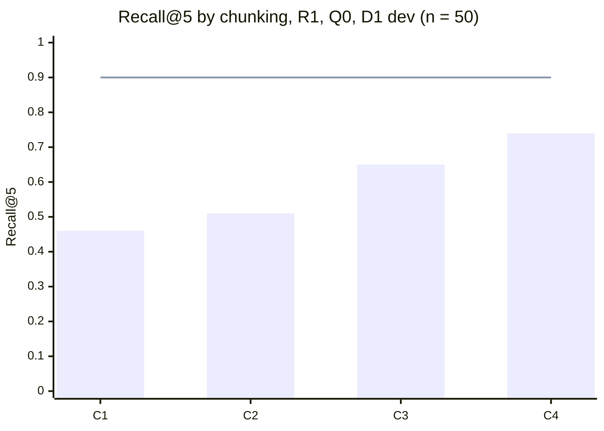
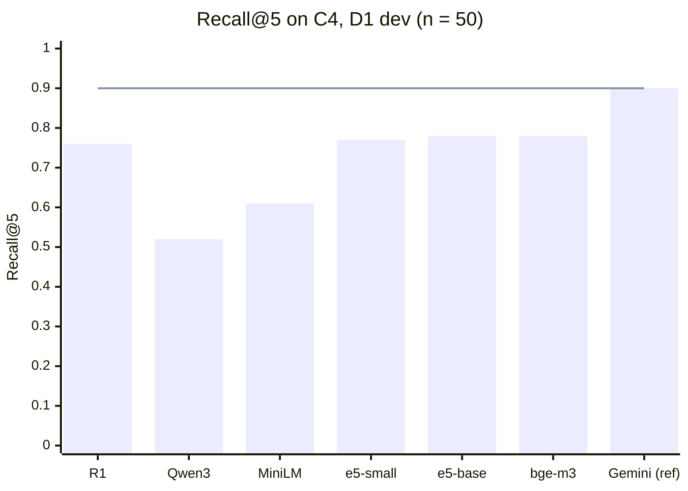
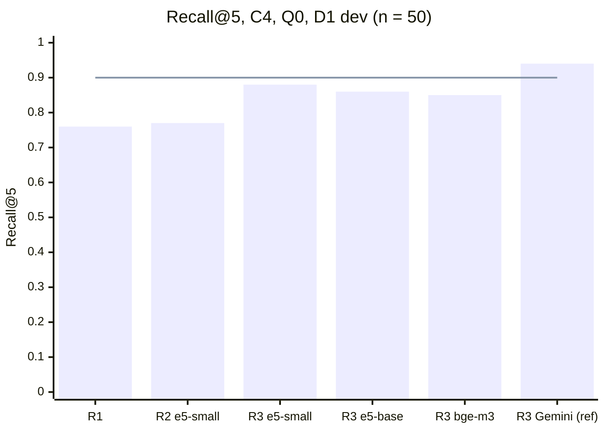

# M3: דוח ניסויי השליפה

| | |
|---|---|
| **סטטוס** | שלב 1 עם R1 הסתיים (4.11.2026). שלב 1 עם R2 רץ על חמישה מועמדים ועל Gemini כנקודת ייחוס. שלב 2 (R1 עד R3) רץ: ‏R3 עם e5-small (ADR-0011, ‏ADR-0012). שלב 3 (Q0 עד Q2) רץ: ‏Q1, והקוד מסיר את השם (ADR-0013). בשלב 4 רצו שלוש הריצות: ‏R4 טוב באופן מובהק מ-R3, ואומץ (ADR-0014). שלב 5 עוד לא רץ |
| **נשען על** | `docs/04-retrieval-design.md`, סעיפים 3 עד 5 ו-9, ‏`docs/03-evaluation-methodology.md`, סעיפים 3, 5 ו-6 |
| **נתונים** | D1, ‏`evals/datasets/d1.yaml` (cfcc537), רק ה-split ‏`dev`. ‏`test` לא רץ ולא נקרא |

הנתונים הגולמיים נמצאים ב-`evals/results/2026-11-04-7f1e048-*.json` (ההרצה הראשונה) וב-`2026-11-04-13d50b9-*.json` (אחרי שינוי שתי השאלות, וזה קו הבסיס). בכל קובץ יש ציון לכל שאלה, ולכן אפשר לחשב כל השוואה מחדש בלי להריץ שוב.

**לשחזור:** מתוך `evals/`, מול Postgres מקומי עם המיגרציות:

```bash
DATABASE_URL=postgresql://... ../backend/.venv/Scripts/python -m retrieval.run_stage1
```

## שלב 1: איזה חיתוך עובד הכי טוב?

### השערה
מפרק 5, סעיף 3, ציר A:
- **C1**, קטע לכל כותרת: יחידות משמעות טבעיות, וציטוטים ברורים.
- **C2**, ‏C1 עם כותרת הקשר (שם הרשומה, `aliases` ו-`tech`): אמור לשפר בעיקר עברית ושאלות `multi_hop`.
- **C3**, חלונות של כ-300 טוקנים עם חפיפה של 50: קו בסיס מקובל.
- **C4**, רשומה שלמה כקטע אחד: במאגר כל כך קטן, אולי זה פשוט מספיק.

### מה השלב הזה בודק, ומה לא
- **רק R1.** לפי פרק 5, שלב 1 רץ עם R1 ועם R2 בנפרד. ל-R2 עוד אין מודל embeddings (ADR-0009). לכן התוצאה עונה רק על השאלה "איזה חיתוך עובד הכי טוב בשליפה מילולית". כשיהיה R2, מריצים את C1 עד C4 שוב באותה פקודה, ובודקים אם המנצח משתנה.
- **50 שאלות בלבד.** 32 בעברית ו-18 באנגלית. 11 מהן `cross_lingual`, והן חלק מ-32 העבריות. רווח הסמך הכולל רחב בערך ±0.12, וב-11 שאלות ה-`cross_lingual` בערך ±0.3. הבדל קטן מזה הוא רעש.
- **R1 דטרמיניסטי,** ולכן ריצה אחת לכל תצורה מספיקה. פרק 4, סעיף 5 דורש 3 ריצות רק לרכיב לא דטרמיניסטי.
- **ה-latency נמדד על PGlite** (Postgres ב-wasm, על המחשב של שרה), ולא על Neon. המספרים טובים רק להשוואה בין התצורות, ולא כהערכה של זמן אמיתי.

### תצורות
| | |
|---|---|
| **שליפה** | R1: ‏BM25 על `tsvector` בתצורת `simple`, ו-trigram משוקלל IDF על הטקסט ועל ה-`aliases`, ממוזגים ב-RRF עם k = 60 |
| **שאילתה** | Q0: השאלה כמו שהיא |
| **מאגר** | 16 רשומות מאושרות. 40 מהקטעים הם קטעי כישורים (`skills#<slug>`), זהים בכל ארבע השיטות |
| **ניקוד** | לפי `Chunk.sections`, כלומר הסעיפים של C1 שכל קטע מכסה. כך אותו `gold_chunks` מנקד את כל השיטות |
| **השוואה** | מזווגת, שאלה מול שאלה, ‏bootstrap של 10,000 דגימות, 95% |

### תוצאות
Recall@5, ממוצע ורווח סמך bootstrap ב-95%. ‏Recall הוא שבר לכל שאלה (למשל 2 מתוך 3 קטעים), ולכן "שאלות מלאות" סופר את השאלות שכל הקטעים הנכונים שלהן נמצאו ב-5 הראשונים.

| | קטעים | כולל (50) | שאלות מלאות | עברית (32) | אנגלית (18) | ‏`cross_lingual` ‏(11) |
|---|---|---|---|---|---|---|
| **C1** | 112 | 0.46 [0.34, 0.59] | 19/50 | 0.42 [0.25, 0.58] | 0.54 [0.35, 0.73] | 0.27 [0.00, 0.55] |
| **C2** | 112 | 0.51 [0.38, 0.64] | 22/50 | 0.46 [0.30, 0.63] | 0.59 [0.41, 0.78] | 0.45 [0.18, 0.73] |
| **C3** | 68 | 0.65 [0.52, 0.76] | 29/50 | 0.67 [0.51, 0.81] | 0.61 [0.42, 0.80] | 0.64 [0.36, 0.91] |
| **C4** | 55 | **0.74 [0.63, 0.85]** | **34/50** | **0.71 [0.56, 0.85]** | **0.81 [0.64, 0.94]** | **0.73 [0.45, 1.00]** |
| **סף (פרק 4)** | | ≥ 0.90 | | ≥ 0.85 | | ≥ 0.85 |

שאר המדדים, על כל 50 השאלות:

| | Recall@3 | Recall@10 | MRR | nDCG@5 | latency ‏p50 / p95 (ms) | טוקנים ב-5 הראשונים |
|---|---|---|---|---|---|---|
| **C1** | 0.33 | 0.70 | 0.41 | 0.37 | 88 / 114 | 523 |
| **C2** | 0.33 | 0.67 | 0.37 | 0.36 | 146 / 187 | 821 |
| **C3** | 0.51 | 0.79 | 0.53 | 0.52 | 87 / 115 | 920 |
| **C4** | 0.59 | 0.83 | 0.57 | 0.59 | 77 / 114 | 1,468 |

"טוקנים" נספרים לפי הביטוי `\w+|[^\w\s]` של `ingest.py`, ולא לפי הטוקנייזר של מודל, כי עוד לא נבחר מודל.



### השוואות מזווגות
הפרש Recall@5 (השנייה פחות הראשונה), עם רווח סמך ב-95%. כוכבית מסמנת הבדל מובהק, כלומר רווח הסמך לא כולל אפס.

| | כולל | עברית | אנגלית | ‏`cross_lingual` |
|---|---|---|---|---|
| C2 − C1 | +0.05 [−0.03, +0.14] | +0.05 [−0.08, +0.19] | +0.06 [0.00, +0.17] | +0.18 [−0.18, +0.55] |
| C3 − C1 | **+0.19 [+0.09, +0.30]\*** | **+0.25 [+0.11, +0.41]\*** | +0.07 [0.00, +0.16] | **+0.36 [+0.09, +0.64]\*** |
| C4 − C1 | **+0.28 [+0.16, +0.41]\*** | **+0.29 [+0.14, +0.46]\*** | **+0.27 [+0.10, +0.45]\*** | **+0.45 [+0.18, +0.73]\*** |
| C3 − C2 | **+0.14 [+0.03, +0.25]\*** | **+0.20 [+0.08, +0.36]\*** | +0.02 [−0.14, +0.14] | +0.18 [0.00, +0.45] |
| C4 − C2 | **+0.23 [+0.11, +0.36]\*** | **+0.24 [+0.10, +0.40]\*** | +0.21 [−0.01, +0.44] | +0.27 [0.00, +0.55] |
| C4 − C3 | **+0.10 [+0.03, +0.18]\*** | +0.04 [0.00, +0.11] | **+0.19 [+0.06, +0.36]\*** | +0.09 [0.00, +0.27] |

### ממצאים
- **אף שיטה לא מתקרבת לסף.** הטובה ביותר, C4, מגיעה ל-0.74, והסף הוא 0.90. בעברית ובשאלות `cross_lingual` אף שיטה לא עוברת 0.85. זה לא מפתיע: R1 משווה מילים, ובשאלה בעברית על רשומה באנגלית אין כמעט מילים משותפות. בדיוק בשביל זה נועדו R2 ו-Q1 (פרק 5, סעיף 3).
- **בשלוש שאלות עבריות R1 לא החזיר אף קטע,** בכל ארבע השיטות (d1-017, ‏d1-018, ‏d1-075). אף מילה בשאלה לא נמצאה בטקסט, ואף מילה לא דמתה מספיק לאחד ה-`aliases`.
- **הכותרת של C2 לא עזרה באופן מובהק.** ההפרש מ-C1 הוא +0.05, ורווח הסמך כולל אפס. ההשערה הייתה שהכותרת תעזור בעיקר בעברית, אבל ההפרש בעברית הוא +0.05 [−0.08, +0.19]. ה-MRR של C2 אפילו נמוך יותר (0.37 מול 0.41). כותרת עם `aliases` ו-`tech` מכפילה כמעט את גודל המאגר (12,119 טוקנים מול 6,666), ומוסיפה אותן מילים לכל קטע של אותה רשומה. לכן היא עוזרת למצוא את הרשומה, אבל לא את הסעיף הנכון בתוכה.
- **C4 מנצח, אבל חלק מהיתרון שלו נובע מכמות הטקסט.** 5 קטעים של C4 הם כ-1,470 טוקנים, פי 2.8 מ-5 קטעים של C1. כשמשווים בכמות טקסט דומה, ההבדל כבר לא מובהק:

  | השוואה, בכמות טקסט דומה | הפרש | מובהק? |
  |---|---|---|
  | C4 ב-Recall@3 (כ-880 טוקנים) מול C3 ב-Recall@5 (כ-920) | −0.06 [−0.17, +0.04] | לא |
  | C4 ב-Recall@5 (כ-1,470) מול C1 ב-Recall@10 (כ-1,050) | +0.04 [−0.04, +0.14] | לא |
  | C4 ב-Recall@5 (כ-1,470) מול C3 ב-Recall@10 (כ-1,840) | −0.05 [−0.13, +0.03] | לא |

  כלומר, החיתוך עצמו לא בהכרח טוב יותר. C4 פשוט מחזיר יותר טקסט בכל קטע. זה רלוונטי לתקציב ההקשר של המודל, והמחיר נמדד בשלבים הבאים, בבדיקות התשובה.
- **C4 עלול לעבור את החוזה של `search_portfolio`,** שמגביל את התשובה ל-3,000 טוקנים (פרק 5, סעיף 8). הקטע הגדול ביותר הוא כ-810 טוקנים (`claims-trust-model#all`). ב-2 מתוך 50 השאלות, 5 הקטעים הראשונים עוברים את 3,000 (עד 3,165).
- **שאלות `multi_hop` ו-`comparative` הן רוב הפספוסים של C4.** 8 מתוך 16 השאלות ש-C4 לא מילא בהן את כל הקטעים הנכונים הן מהסוג הזה. רשומה שלמה עוזרת כשכל התשובה ברשומה אחת. היא לא עוזרת כשהתשובה מפוזרת על שלוש רשומות.

### הכרעה
לפי כלל ההכרעה (פרק 5, סעיף 5): התצורה הפשוטה ביותר שאינה גרועה באופן מובהק מהטובה ביותר.

- **הטובה ביותר:** C4. התנאי הוא שהיא עוברת את סף העברית, אבל אף שיטה לא עוברת אותו. לכן "הטובה ביותר" נקבעת כאן לפי Recall@5 הכולל בלבד, וזה נרשם במפורש.
- **סדר הפשטות** (פחות רכיבים קודם): C4, רשומה שלמה. אחריו C1, קטע לכל כותרת. אחריו C2, אותו דבר עם כותרת הקשר. ואחרון C3, חלונות, שמוסיפים גודל, חפיפה וכלל כיסוי של סעיפים.
- **C1, ‏C2 ו-C3 גרועות באופן מובהק מ-C4** ב-Recall@5 הכולל (−0.28, ‏−0.23 ו-−0.10, ואף רווח סמך לא כולל אפס).

**ההכרעה עם R1: ‏C4** ([ADR-0010](../adr/0010-chunking.md), אושר על ידי שרה). היא זמנית, משתי סיבות:
1. **R2 עוד לא נמדד.** עם embeddings, קטעים קטנים וממוקדים עשויים לעבוד אחרת. כשיהיה R2, שלב 1 רץ שוב.
2. **היתרון של C4 תלוי בכמות הטקסט.** בכמות טקסט דומה, ההבדל לא מובהק. אם בדיקות התשובה יראו שקטעים של רשומה שלמה ארוכים מדי לתקציב ההקשר, או פוגעים בדיוק הציטוטים (ציטוט של רשומה שלמה פחות מדויק מציטוט של סעיף), ההכרעה נפתחת מחדש.

### שתי שאלות שנבדקו ליד קו הבסיס
שתי השאלות האלה נבדקו קודם כניסויים נגדיים בלבד, על `dev`, בלי לשנות קוד. ההחלטה עליהן וההרצה החוזרת מופיעות בהמשך.

**1. שדות `metrics` בכותרת הרשומה לא נחתכים לקטעים.**
- ב-11 ערכי `metrics` של 4 רשומות, 7 לא מופיעים מילה במילה בגוף הטקסט. למשל "1,237 lines of TypeScript", ‏"108 (about 9,800 lines)" ו-"about 30-80ms".
- **ניסוי נגדי:** הוספנו את ה-`metrics` לסוף הסעיף `results` של כל רשומה, והרצנו שוב. מבין 13 שאלות ה-`dev` שעוסקות במספרים, אף שאלה לא השתנתה ב-C1, ‏C2 ו-C4. ב-C3 שאלה אחת ירדה (−0.02 בסך הכול, לא מובהק).
- **המשמעות:** ב-`dev` אין שאלה שהתשובה שלה נמצאת רק ב-`metrics`. לכן D1 לא יכול להראות את הבעיה. אם מבקר ישאל "כמה מיגרציות SQL היו?", R1 לא ימצא את המספר בטקסט. **ההחלטה לשרה:** להוסיף את ה-`metrics` לטקסט של הקטעים, להוסיף ל-D1 שאלות על מספרים שנמצאים רק שם, או להשאיר כמו שזה.

**2. קטעי הכישורים מפרטים את מזהי הרשומות שמשמשות ראיה, ולכן הם תופסים מילים של הפרויקטים.**
- למשל, `skills#postgresql` כולל "Evidence: claims-trust-model, postgres-rls-backbone, …, weed-detection-pipeline". שאלה על "weed detection" מתאימה גם לו.
- בשאלות שהתשובה שלהן לא בכישורים, קטעי כישורים תופסים בממוצע 0.26 מ-5 המקומות ב-C1, ‏0.10 ב-C2, ‏0.31 ב-C3 ו-0.40 ב-C4. ב-C4, ‏40 מתוך 55 הקטעים הם קטעי כישורים.
- **ניסוי נגדי:** הסרנו את "Evidence: …" מקטעי הכישורים, והרצנו שוב:

  | | לפני | אחרי | הפרש | מובהק? |
  |---|---|---|---|---|
  | C1 | 0.46 | 0.51 | +0.05 [0.00, +0.12] | לא |
  | C2 | 0.51 | 0.52 | +0.01 [−0.05, +0.07] | לא |
  | C3 | 0.65 | 0.68 | +0.03 [0.00, +0.08] | לא |
  | C4 | 0.74 | 0.76 | +0.02 [0.00, +0.06] | לא |

  ב-8 השאלות שהתשובה שלהן כן בכישורים, ההסרה לא פגעה: 8/8 אחרי, לעומת 7/8 לפני ב-C1 עד C3.
- **המשמעות:** ההסרה עוזרת מעט בכל השיטות, ולא פוגעת באף שאלה, אבל אף הפרש לא מובהק ב-50 שאלות. היא גם לא משנה את ההכרעה: C4 נשאר הטוב ביותר (0.76). **ההחלטה לשרה:** להסיר את המזהים מהטקסט שעובר אינדוקס, ולשמור אותם רק כ-metadata לציטוט, או להשאיר כמו שזה.

### ההחלטה על שתי השאלות, והרצה חוזרת
שרה השאירה את ההחלטה לשיקול דעת (4.11.2026). שני השינויים נכנסו ב-13d50b9:
- **`metrics` נכנסים לטקסט.** הם נוספים לסוף הסעיף `results`, ולצד כל ערך כתוב גם איך הוא נמדד (`how_measured`), כדי שהסוכן יוכל לצטט את המספר עם ההסתייגות שלו. ב-D1 אין שאלה שבודקת את זה, אבל בלי השינוי מספר כמו "108 מיגרציות" לא היה נמצא בכלל. **ל-D1 כדאי להוסיף שאלות על מספרים שנמצאים רק ב-`metrics`,** בגרסה הבאה של D1, ושרה תתייג אותן.
- **מזהי הראיות של הכישורים יוצאים מהאינדקס.** הם נשארים בטקסט שהסוכן מקבל (`Chunk.display`, העמודה `text`), כדי שיוכל לומר איפה שרה השתמשה בכישור. הם לא נכנסים ל-`norm`, ולכן לא ל-BM25, ל-trigram ול-embeddings. מזהה רשומה הוא מזהה, ולא תוכן של הכישור.

אף אחד מהשינויים לא מבוסס על הבדל מובהק. שניהם תיקונים של התוכן שעובר אינדוקס, ובהרצה החוזרת אף אחד מהם לא פגע באופן מובהק.

| | Recall@5 כולל, לפני (7f1e048) | אחרי (13d50b9) | הפרש מזווג | שאלות מלאות אחרי |
|---|---|---|---|---|
| **C1** | 0.46 | 0.51 [0.38, 0.64] | +0.05 [0.00, +0.12] | 22/50 |
| **C2** | 0.51 | 0.52 [0.39, 0.65] | +0.01 [−0.05, +0.07] | 23/50 |
| **C3** | 0.65 | 0.66 [0.53, 0.78] | +0.01 [−0.05, +0.07] | 30/50 |
| **C4** | 0.74 | **0.76 [0.65, 0.87]** | +0.02 [0.00, +0.06] | **35/50** |

- **ההכרעה לא משתנה.** C4 עדיין הטוב ביותר, ו-C1, ‏C2 ו-C3 עדיין גרועות ממנו באופן מובהק (−0.25, ‏−0.24 ו-−0.11). אף שיטה עדיין לא עוברת את סף העברית.
- **ב-C4 השתנתה רק שאלה אחת,** d1-049 ("What accuracy did her plant health model reach?"), מ-0 ל-1. קודם, שני קטעי כישורים שמזכירים את הרשומה כראיה דחקו את הרשומה עצמה מה-5 הראשונים.
- **ב-C2 וב-C3 שאלה אחת ירדה ושאלה אחרת עלתה.** ב-`cross_lingual` ההפרש הוא −0.09 [−0.27, 0.00], לא מובהק. זו שאלה אחת מתוך 11.
- **מעכשיו, קו הבסיס לשלבים הבאים הוא 13d50b9.** הקבצים של 7f1e048 נשארים ב-`evals/results/` כתיעוד של ההרצה הראשונה.

## שלב 1 עם R2: אותו חיתוך, עם embeddings

### מה רץ
- **אותה פקודה, עם שם של מודל:** `python -m retrieval.run_stage1 <model>`. אותן 50 שאלות `dev`, אותם קטעים, ואותו ניקוד. ‏R2 מחשב embedding לאותו טקסט ש-R1 מאנדקס (`Chunk.content`), ומדרג לפי מרחק cosine ב-pgvector.
- **המודלים** (`evals/retrieval/embedders.py`, ‏`CANDIDATES`):

  | | ממדים | אורך מקסימלי | איפה רץ | רישיון (לפי Hugging Face) | מותר בפרודקשן? (ADR-0009) |
  |---|---|---|---|---|---|
  | **multilingual-e5-small** | 384 | 512 טוקנים | ONNX מקוונטז, בתוך הפונקציה | MIT | כן |
  | **multilingual-e5-base** | 768 | 512 | ONNX מקוונטז, בתוך הפונקציה | MIT | כן |
  | **paraphrase-multilingual-MiniLM-L12-v2** | 384 | 128 | ONNX מקוונטז, בתוך הפונקציה | Apache-2.0 | כן |
  | **bge-m3** | 1024 | 60,000 (לפי Cloudflare) | Cloudflare Workers AI | MIT | כן, לפי התנאים שלהלן |
  | **qwen3-embedding-0.6b** | 1024 | 8,192 | Cloudflare Workers AI | Apache-2.0 | כן, לפי התנאים שלהלן |
  | **gemini-embedding-001** | 768 | | Gemini API | | **לא.** נקודת ייחוס בלבד |

- **הרישיונות** נקראו מהשדה `license` בכרטיס של כל מודל ב-Hugging Face (4.11.2026). שני הרישיונות, MIT ו-Apache-2.0, מתירים שימוש מסחרי וציבורי, בתנאי שמצרפים את הודעת הרישיון.
- **התנאים של Cloudflare Workers AI** (4.11.2026):
  - **מכסה:** בתוכנית החינמית יש "10,000 Neurons per day". מעבר לזה, "further operations will fail with an error", כלומר בלי חיוב. המכסה מתאפסת ב-00:00 UTC.
  - **מחיר של bge-m3:** ‏1,075 neurons למיליון טוקנים. שאלה של מבקר היא כמה עשרות טוקנים, ולכן המכסה היומית מספיקה לעשרות אלפי שאלות.
  - **אימון על התוכן:** לפי Service-Specific Terms, סעיף 1, ‏"Cloudflare does not use any Customer Content to train generative AI tools".
  - **מודלים של צד שלישי:** לפי סעיף 3, השימוש "may be subject to additional terms" של ספק המודל. כאן אלה הרישיונות שבטבלה.
  - **שימוש ציבורי:** לא מצאתי סעיף שמגביל אפליקציה ציבורית. זה בניגוד ל-Gemini (ADR-0009). **גם כאן, זו לא חוות דעת משפטית.**
- **הקבצים:** `evals/results/2026-11-04-612b3b4-stage1-*-R2-*.json` לשלושת המודלים הפתוחים, ‏`2026-11-04-509c1f3-*-R2-gemini-embedding-001-*.json` ל-Gemini, ו-`2026-11-04-01b7893-*-R2-{bge-m3,qwen3-embedding-0.6b}-*.json` למודלים של Cloudflare. בין שתי הגרסאות השתנה רק ניסיון חוזר על שגיאת 429, ולא שום דבר שמשפיע על הציון. ‏R2 דטרמיניסטי עם embeddings שמורים, ולכן ריצה אחת מספיקה. ‏Gemini רץ פעמיים, משני סשנים, ושמות הקבצים זהים, ולכן נשמרה רק ריצה אחת. ה-Recall@5 של שתי הריצות היה זהה בשתי ספרות אחרי הנקודה.

### תוצאות
Recall@5, ממוצע. השורה של R1 היא קו הבסיס (13d50b9).

| | | כולל (50) | שאלות מלאות | עברית (32) | אנגלית (18) | ‏`cross_lingual` ‏(11) | MRR | nDCG@5 |
|---|---|---|---|---|---|---|---|---|
| **R1** | C3 | 0.66 | 30/50 | 0.64 | 0.69 | 0.55 | 0.53 | 0.52 |
| | C4 | 0.76 | 35/50 | 0.71 | 0.86 | 0.73 | 0.60 | 0.62 |
| **e5-small** | C1 | 0.48 | 22/50 | 0.37 | 0.68 | 0.36 | 0.40 | 0.37 |
| | C2 | 0.56 | 23/50 | 0.43 | 0.79 | 0.55 | 0.50 | 0.46 |
| | C3 | 0.77 | 34/50 | 0.71 | 0.88 | 0.64 | 0.63 | 0.62 |
| | C4 | 0.77 | 33/50 | 0.75 | 0.80 | 0.82 | 0.67 | 0.64 |
| **e5-base** | C1 | 0.49 | 20/50 | 0.43 | 0.59 | 0.55 | 0.46 | 0.41 |
| | C2 | 0.61 | 26/50 | 0.57 | 0.68 | 0.73 | 0.50 | 0.48 |
| | C3 | **0.81** | 35/50 | **0.82** | 0.80 | 0.91 | 0.71 | 0.69 |
| | C4 | 0.78 | 34/50 | 0.80 | 0.76 | 1.00 | 0.64 | 0.62 |
| **MiniLM** | C1 | 0.43 | 18/50 | 0.38 | 0.52 | 0.45 | 0.35 | 0.33 |
| | C2 | 0.39 | 17/50 | 0.37 | 0.43 | 0.36 | 0.27 | 0.27 |
| | C3 | 0.64 | 27/50 | 0.61 | 0.69 | 0.64 | 0.61 | 0.57 |
| | C4 | 0.61 | 26/50 | 0.62 | 0.59 | 0.82 | 0.59 | 0.55 |
| **bge-m3** | C1 | 0.57 | 26/50 | 0.53 | 0.64 | 0.55 | 0.45 | 0.45 |
| | C2 | 0.70 | 32/50 | 0.69 | 0.71 | 0.91 | 0.62 | 0.60 |
| | C3 | 0.77 | 34/50 | 0.78 | 0.75 | 1.00 | 0.67 | 0.65 |
| | C4 | 0.78 | 34/50 | 0.79 | 0.75 | 1.00 | 0.73 | 0.70 |
| **Qwen3-0.6B** | C1 | 0.31 | 12/50 | 0.23 | 0.46 | 0.18 | 0.30 | 0.26 |
| | C2 | 0.46 | 20/50 | 0.40 | 0.57 | 0.55 | 0.39 | 0.37 |
| | C3 | 0.55 | 24/50 | 0.53 | 0.59 | 0.64 | 0.51 | 0.48 |
| | C4 | 0.52 | 23/50 | 0.48 | 0.59 | 0.55 | 0.49 | 0.46 |
| **Gemini (ייחוס)** | C1 | 0.65 | 28/50 | 0.66 | 0.64 | 0.73 | 0.48 | 0.47 |
| | C2 | 0.80 | 34/50 | 0.83 | 0.75 | 0.91 | 0.65 | 0.63 |
| | C3 | 0.87 | 39/50 | 0.88 | 0.85 | 1.00 | 0.81 | 0.77 |
| | C4 | **0.90** | **42/50** | **0.90** | **0.90** | **1.00** | **0.86** | **0.83** |
| **סף (פרק 4)** | | ≥ 0.90 | | ≥ 0.85 | | ≥ 0.85 | | |



### זמן וגודל
נמדד ב-`embed_timing.py`, על thread אחד במחשב של שרה, אחרי שאילתת חימום אחת. הזמן הוא רק ה-embedding של השאלה, ולא החיפוש עצמו.

| | שאילתה, ממוצע | טעינת המודל (נוספת ל-cold start) | קבצים |
|---|---|---|---|
| **e5-small** | 9ms | 0.95 שניות | 135MB |
| **e5-base** | 28ms | 1.24 שניות | 296MB |
| **MiniLM** | 8ms | 0.88 שניות | 135MB |
| **bge-m3** (Cloudflare) | 819ms (p50 ‏749, ‏p95 ‏1,196), מהמחשב של שרה ולא מאזור Vercel | | |
| **Gemini** | 740ms, מהמחשב של שרה ולא מאזור Vercel | | |

ה-latency בקבצי התוצאות (כ-3 עד 5ms) הוא החיפוש ב-PGlite בלבד, כי ה-embeddings של השאלות שמורים. ה-p50 הגבוה של C1 (55 עד 863ms) כולל את חישוב ה-embeddings הראשון, ולא מייצג את החיפוש.

### השוואות מזווגות
הפרש Recall@5 הכולל, עם רווח סמך ב-95%. כוכבית מסמנת הבדל מובהק.

| השוואה | הפרש |
|---|---|
| e5-base C4 פחות R1 C4 | +0.02 [−0.09, +0.14] |
| e5-base C3 פחות R1 C4 | +0.05 [−0.06, +0.16] |
| e5-small C4 פחות R1 C4 | 0.00 [−0.12, +0.13] |
| MiniLM C4 פחות R1 C4 | **−0.15 [−0.29, 0.00]\*** |
| Gemini C4 פחות R1 C4 | **+0.13 [+0.02, +0.25]\*** (עברית: **+0.19 [+0.05, +0.34]\***) |
| e5-base C4 פחות Gemini C4 | **−0.11 [−0.20, −0.03]\*** |
| e5-small C4 פחות Gemini C4 | **−0.13 [−0.23, −0.04]\*** |
| bge-m3 C4 פחות R1 C4 | +0.01 [−0.11, +0.14] |
| bge-m3 C4 פחות e5-base C4 | −0.01 [−0.08, +0.07] |
| bge-m3 C4 פחות Gemini C4 | **−0.12 [−0.20, −0.05]\*** |
| Qwen3 C4 פחות R1 C4 | **−0.24 [−0.39, −0.10]\*** |
| e5-small C3 פחות e5-base C3 | −0.04 [−0.13, +0.04] |
| C4 פחות C3, בכל אחד מהמודלים | לא מובהק באף מודל (e5-base: ‏−0.03 [−0.10, +0.03]) |

### ממצאים
- **הכרעת החיתוך לא משתנה.** לפי כלל ההכרעה, C4 נבחר בכל אחד מששת המודלים. ב-e5 וב-MiniLM ‏C3 הכי טוב בממוצע, אבל C4 לא גרוע ממנו באופן מובהק, והוא פשוט יותר. ב-Gemini ‏C4 הוא גם הטוב ביותר. ‏C1 ו-C2 גרועים באופן מובהק בכל המודלים. **ADR-0010 נשאר C4.**
- **רק Gemini עובר את הספים,** בדיוק על הקו: 0.90 בכולל, 0.90 בעברית, ו-1.00 ב-`cross_lingual`. הוא גם מוצא את שלוש השאלות העבריות ש-R1 לא החזיר בהן כלום. אבל הוא אסור בפרודקשן (ADR-0009). ההישג שלו מראה שהספים אפשריים על D1, ושהפער הוא במודל, ולא במאגר או בחיתוך.
- **שום מודל פתוח לא טוב באופן מובהק מ-R1 לבדו.** ‏e5-base מוסיף +0.02 על C4. בעברית ובשאלות `cross_lingual` הוא עוזר (+0.09 ו-+0.27), אבל רווחי הסמך כוללים אפס. באנגלית הוא קצת גרוע מ-R1. ‏MiniLM גרוע מ-R1 באופן מובהק, כנראה כי הוא קורא רק 128 טוקנים, ולכן רוב הקטעים נחתכים.
- **R1 ו-e5 טועים בשאלות שונות.** ב-C4, ‏R1 טוב יותר ב-9 שאלות, ו-e5-base טוב יותר ב-7 אחרות. אם בוחרים בכל שאלה את הטוב מבין השניים, מגיעים ל-0.88. זו תקרה, ולא תוצאה של מיזוג אמיתי, אבל זה בדיוק מה ש-R3 (מיזוג ב-RRF) בשלב 2 נועד לנצל.
- **e5 חותך 6 מתוך 15 רשומות של C4 ב-512 טוקנים.** החלק שאחרי החיתוך לא נכנס ל-embedding. זה אחד ההסברים לכך ש-C3 עובד ב-e5 טוב יותר מ-C4.
- **e5-small מספיק כמעט כמו e5-base,** בחצי מהגודל ובשליש מהזמן. ההפרש ב-C3 הוא −0.04, ולא מובהק.
- **bge-m3 לא טוב יותר מ-e5-base,** למרות שהוא גדול יותר וקורא 60,000 טוקנים בלי חיתוך. ההפרש ב-C4 הוא −0.01. גם הוא גרוע מ-Gemini באופן מובהק (−0.12). יש לו שני חסרונות: הוא מוסיף כ-800ms לכל שאלה (נמדד מהמחשב של שרה), ויש לו תלות בספק חיצוני ובמכסה יומית.
- **Qwen3-0.6B גרוע מ-R1 באופן מובהק** (−0.24), ובעברית במיוחד (0.48). כדי לוודא שזו לא תקלה בצורת הקריאה, בדקנו שלוש צורות קריאה ל-Cloudflare על דוגמה קטנה: `text` עם ההוראה שלנו, `text` בלי הוראה, ו-`queries` עם ההוראה של Cloudflare. ‏`text` ו-`documents` מחזירים וקטורים זהים, וההוראה שלנו נתנה את ההפרדה הטובה ביותר בעברית. לכן זו לא תקלה. המודל פשוט חלש על D1.
- **bge-m3 משלים את R1 כמו e5.** ‏R1 טוב יותר ב-10 שאלות, ו-bge-m3 ב-7 אחרות. התקרה של הטוב מבין השניים היא 0.89, לעומת 0.88 עם e5-base.

### מה זה אומר על בחירת המודל
*(זו הייתה המסקנה אחרי שלב 1. ההכרעה הסופית נעשתה בשלב 2, ‏ADR-0012.)*

**אף מועמד מותר לא עובר את הספים לבדו.** הטובים ביותר הם e5-base ו-bge-m3 (0.78 ב-C4), ו-e5-small קרוב אליהם (0.77). ההבדלים ביניהם לא מובהקים. לכן, לפי כלל ההכרעה, הפשוט ביותר מנצח בשלב הזה: **e5-small**, שרץ בתוך הפונקציה, בלי ספק חיצוני, ב-9ms לשאילתה וב-135MB. ‏e5-base נשאר מועמד אם שלב 2 יראה שההפרש ביניהם חשוב.

**זו לא עוד הכרעה סופית, ואין ADR.** ההכרעה תלויה בשלב 2: אם R3 (המיזוג עם R1) מגיע לסף עם מודל קטן, המודל נבחר. אם לא, בודקים את המועמדים הנוספים שלהלן, או את שלב 3 (Q1 ו-Q2). ‏bge-m3 לא מוצדק: הוא לא טוב יותר, הוא איטי יותר, והוא תלוי ב-Cloudflare.

**מועמדים נוספים, אם אלה לא יספיקו:** מודלים פתוחים עם הקשר ארוך (8,192 טוקנים), כמו `gte-multilingual-base` ו-`snowflake-arctic-embed-m-v2.0`, שלא חותכים את C4. ‏EmbeddingGemma, אחרי קריאה של תנאי Gemma.

## שלב 2: האם היברידי מצדיק את עצמו?

### השערה
מפרק 5, סעיף 3, ציר B: ‏R1 מוצא מילים, ו-R2 מוצא משמעות, גם בין עברית לאנגלית. בשלב 1 ראינו ששתי השיטות טועות בשאלות שונות, והתקרה של "הטוב מבין השניים" היא 0.88 עד 0.89. ‏R3 ממזג את שתיהן, ולכן הוא אמור להתקרב לתקרה הזו.

### תצורות
| | |
|---|---|
| **חיתוך** | C4, לפי ADR-0010 |
| **שאילתה** | Q0 |
| **R1** | כמו בשלב 1 |
| **R2** | מודל אחד בכל הרצה: e5-small, ‏e5-base ו-bge-m3, ו-Gemini כנקודת ייחוס |
| **R3** | `backend/portfolio_agent/retrieval/hybrid.py`: ‏20 המועמדים הראשונים של R1 ו-20 של R2, ממוזגים ב-RRF עם k = 60, כשתי רשימות שוות משקל. ‏R1 עצמו כבר ממזג BM25 ו-trigrams, אבל כאן הוא נספר כרשימה אחת. אחרת, החיפוש המילולי היה מקבל פי שניים משקל |
| **סדר הפשטות** | R1 (בלי מודל), אחריו R2 (מודל אחד), ואחרון R3 (שניהם) |

**לשחזור:** `python -m retrieval.run_stage2 <model>`. הנתונים ב-`evals/results/2026-11-04-8c5b5c3-stage2-*.json`. כל שלוש השיטות מחפשות באותה טבלה ובאותם embeddings, וההשוואה מזווגת, שאלה מול שאלה.

### תוצאות
Recall@5 על C4. השורה של R1 זהה בכל ההרצות, ושווה לקו הבסיס של שלב 1.

| | כולל (50) | שאלות מלאות | עברית (32) | אנגלית (18) | ‏`cross_lingual` ‏(11) | Recall@3 | Recall@10 | MRR |
|---|---|---|---|---|---|---|---|---|
| **R1** | 0.76 [0.65, 0.87] | 35/50 | 0.71 | 0.86 | 0.73 | 0.66 | 0.83 | 0.60 |
| **R2 ‏e5-small** | 0.77 [0.67, 0.86] | 33/50 | 0.75 | 0.80 | 0.82 | 0.66 | 0.89 | 0.67 |
| **R3 ‏e5-small** | **0.88 [0.80, 0.95]** | 40/50 | **0.86** | **0.92** | **0.91** | 0.78 | 0.94 | 0.76 |
| **R3 ‏e5-base** | 0.86 [0.78, 0.94] | 40/50 | 0.85 | 0.88 | 1.00 | 0.76 | 0.95 | 0.71 |
| **R3 ‏bge-m3** | 0.85 [0.76, 0.93] | 39/50 | 0.85 | 0.85 | 1.00 | 0.83 | 0.92 | 0.80 |
| **R2 ‏Gemini (ייחוס)** | 0.90 [0.82, 0.96] | 42/50 | 0.90 | 0.90 | 1.00 | 0.84 | 0.93 | 0.86 |
| **R3 ‏Gemini (ייחוס)** | 0.94 [0.88, 0.98] | 44/50 | 0.92 | 0.96 | 1.00 | 0.88 | 0.97 | 0.83 |
| **סף (פרק 4)** | ≥ 0.90 | | ≥ 0.85 | | ≥ 0.85 | | | |



**Latency.** ‏R3 עם e5-small: ‏p50 ‏99ms ו-p95 ‏145ms, על PGlite. רוב הזמן הוא R1 (כ-90ms), כי ה-embeddings של השאלות שמורים. בפרודקשן מתווספים כ-9ms ל-embedding של השאלה (שלב 1, "זמן וגודל"). זה בתוך תקציב של 300ms ב-p50 (פרק 5, סעיף 2), אבל המדידה האמיתית תהיה על Neon.

### השוואות מזווגות
הפרש Recall@5, עם רווח סמך ב-95%. כוכבית מסמנת הבדל מובהק.

| | כולל | עברית | אנגלית | ‏`cross_lingual` |
|---|---|---|---|---|
| R3 פחות R1, ‏e5-small | **+0.12 [+0.04, +0.21]\*** | **+0.15 [+0.05, +0.28]\*** | +0.06 [−0.04, +0.19] | +0.18 [0.00, +0.45] |
| R3 פחות R2, ‏e5-small | **+0.11 [+0.05, +0.19]\*** | **+0.11 [+0.03, +0.22]\*** | **+0.12 [+0.02, +0.26]\*** | +0.09 [0.00, +0.27] |
| R3 פחות R1, ‏e5-base | **+0.10 [+0.01, +0.20]\*** | **+0.15 [+0.03, +0.28]\*** | +0.02 [−0.11, +0.17] | +0.27 [0.00, +0.55] |
| R3 פחות R2, ‏e5-base | **+0.08 [+0.04, +0.13]\*** | **+0.06 [+0.01, +0.11]\*** | **+0.12 [+0.04, +0.21]\*** | 0.00 |
| R3 פחות R1, ‏bge-m3 | +0.09 [−0.01, +0.20] | **+0.15 [+0.03, +0.28]\*** | −0.01 [−0.15, +0.15] | +0.27 [0.00, +0.55] |
| R3 e5-base פחות R3 e5-small | −0.02 [−0.08, +0.05] | −0.01 [−0.10, +0.09] | −0.04 [−0.09, 0.00] | |
| R3 bge-m3 פחות R3 e5-small | −0.03 [−0.10, +0.05] | −0.01 [−0.11, +0.11] | −0.06 [−0.14, 0.00] | |
| R2 Gemini פחות R3 e5-small | +0.02 [−0.06, +0.10] | +0.04 [−0.06, +0.15] | −0.02 [−0.11, +0.08] | |
| R3 Gemini פחות R3 e5-small | **+0.06 [0.00, +0.13]\*** | +0.06 [−0.01, +0.17] | +0.05 [0.00, +0.12] | |

### ממצאים
- **ההיברידי מצדיק את עצמו.** עם e5-small ועם e5-base, ‏R3 טוב באופן מובהק גם מ-R1 וגם מ-R2. הוא מוסיף +0.12 ו-+0.11 בציון הכולל, ו-+0.15 בעברית. זו ההתאמה הראשונה בניסויים שעוברת את סף העברית במודל מותר: 0.86 בעברית ו-0.91 ב-`cross_lingual`.
- **R3 מגיע כמעט לתקרה של שלב 1.** ‏0.88 עם e5-small, בדיוק "הטוב מבין R1 ו-R2" שחושב שם. כלומר, המיזוג מנצל כמעט את כל ההשלמה בין שתי השיטות.
- **עם R3, המודל הקטן לא נופל מהגדולים.** ‏e5-base ו-bge-m3 לא טובים ממנו, ובאנגלית אפילו מעט פחות (−0.04 ו-−0.06, לא מובהק). ‏R1 מכסה את מה ש-e5-small מפספס, ולכן גודל המודל חשוב פחות.
- **R3 עם e5-small לא גרוע באופן מובהק מ-Gemini לבדו** (+0.02 [−0.06, +0.10]). ‏Gemini נשאר אסור, אבל המודל המותר והקטן מגיע לאותה רמה בעזרת R1. ‏R3 עם Gemini עדיין טוב יותר (+0.06, מובהק בקושי).
- **עם bge-m3, כלל ההכרעה בוחר דווקא R1,** כי רווח הסמך של R3 מול R1 נוגע באפס (−0.01). זה לא משנה את ההכרעה הכוללת, כי bge-m3 לא נבחר.
- **הסף הכולל, 0.90, עוד לא הושג** (0.88 [0.80, 0.95]). מבין 10 השאלות ש-R3 עם e5-small לא מילא, 8 הן `multi_hop` או `comparative`, שהתשובה שלהן מפוזרת על כמה רשומות. ‏Recall@10 הכולל כבר 0.94, כלומר רוב הקטעים החסרים נמצאים מיד אחרי 5 הראשונים. שתי הנותרות הן עבריות (d1-018 ו-d1-083), ו-e5-small לא מוצא אותן. ‏d1-018 היא אחת משלוש השאלות ש-R1 לא החזיר בהן כלום. ‏bge-m3 ו-Gemini כן מוצאים אותה.

### הכרעה
לפי כלל ההכרעה (פרק 5, סעיף 5). שרה אישרה (4.11.2026):
- **שיטת השליפה: R3.** הוא הטוב ביותר, הוא עובר את סף העברית, ו-R1 ו-R2 גרועים ממנו באופן מובהק. לכן הוא נבחר, למרות שהוא הכי פחות פשוט.
- **מודל ה-embeddings: e5-small.** בתוך R3, אף מודל מותר לא טוב ממנו באופן מובהק. הוא גם הפשוט ביותר: הוא רץ בתוך הפונקציה, ב-9ms לשאילתה, ב-135MB, עם טעינה של כ-1 שנייה ב-cold start, ותחת רישיון MIT. אין בו ספק חיצוני ואין מכסה.

שתי ההכרעות נרשמו ב-[ADR-0011](../adr/0011-retrieval-method.md) (שיטת השליפה) וב-[ADR-0012](../adr/0012-embeddings-model.md) (מודל ה-embeddings, שסוגר את השורה הפתוחה ב-ADR-0009).

**מה שעדיין פתוח:**
- **הסף הכולל.** שלב 3 (Q1) הוא הסיכוי העיקרי, כי ניסוח מחדש של השאלה עוזר בדיוק בשאלות `multi_hop` ו-`comparative`. אפשרות נוספת היא להחזיר יותר קטעים: ‏Recall@10 כבר 0.94, אבל זה מתנגש בתקציב של 3,000 טוקנים, כי קטעים של C4 ארוכים.
- **ה-cold start של e5-small** (כ-1 שנייה של טעינה), ו-**גודל החבילה** (135MB) מול המגבלה של Vercel. שניהם נמדדים בפריסה עצמה, ב-M4.

## שלב 3: כמה Q1 משפר בעברית?

### השערה
מפרק 5, סעיף 3, ציר C: הסוכן ממילא כותב את השאילתה, כפרמטר של `search_portfolio`, וסכמת הכלי מבקשת שאילתה באנגלית. לכן התרגום מגיע בלי קריאה נוספת. ‏Q2 מוסיף שני ניסוחים חלופיים, ואמור לעזור בשאלות `multi_hop`, שבהן היו רוב הפספוסים בשלב 2.

### תצורות
| | |
|---|---|
| **קבוע** | C4 (ADR-0010), ‏R3 (ADR-0011), ‏e5-small (ADR-0012) |
| **Q0** | השאלה של המבקר כמו שהיא |
| **Q1** | ‏Groq ‏`openai/gpt-oss-120b` מקבל את השאלה ואת הכלי, וחייב לקרוא לו. השאילתה היא הפרמטר `query` |
| **Q2** | אותו דבר, עם שדה נוסף, `alternative_queries`, של שני ניסוחים. כל אחת משלוש השאילתות מריצה R3, ושלוש הרשימות ממוזגות ב-RRF |
| **ההנחיה** | ההנחיה של ניסוי S3. ההנחיה האמיתית של הסוכן נכתבת ב-M4 |
| **ריצות** | Q1 נוצר פעם אחת (פרק 5, סעיף 3). ‏Q2 נוצר 3 פעמים, כי הוא לא דטרמיניסטי, והציון שלו לכל שאלה הוא הממוצע של שלוש הריצות |
| **עלות** | כ-86,000 טוקנים: כ-17,000 ל-Q1 וכ-23,000 לכל ריצה של Q2. זה כ-43% מהמכסה היומית של המודל, מתחת לתקרה של 80% לבדיקות (פרק 11, סעיף 3) |

**לשחזור:** `python -m retrieval.rewrite q1` ו-`python -m retrieval.rewrite q2 <run>` יוצרים את השאילתות, ושומרים אותן ב-`evals/datasets/queries/`. קובץ שכבר קיים לא נוצר מחדש. ‏`python -m retrieval.run_stage3` מריץ את השלב. התוצאות נמצאות ב-`evals/results/2026-11-04-c154973-stage3-*.json`.

### תוצאות
| | כולל (50) | שאלות מלאות | עברית (32) | אנגלית (18) | ‏`cross_lingual` ‏(11) | MRR | latency ‏p50 (ms) |
|---|---|---|---|---|---|---|---|
| **Q0** | **0.88 [0.80, 0.95]** | 40/50 | 0.86 | **0.92** | 0.91 | 0.76 | 108 |
| **Q1** | 0.78 [0.68, 0.87] | 33/50 | 0.77 | 0.80 | **1.00** | 0.56 | 249 |
| **Q2** (ממוצע של 3) | 0.82 [0.74, 0.89] | לא רלוונטי לממוצע | 0.82 | 0.82 | **1.00** | 0.53 | כ-1,050 |

שלוש הריצות של Q2: ‏0.85, ‏0.79 ו-0.82.

| | כולל | עברית | אנגלית | ‏`cross_lingual` |
|---|---|---|---|---|
| Q1 פחות Q0 | −0.10 [−0.21, 0.00] | −0.09 [−0.25, +0.05] | −0.12 [−0.26, 0.00] | +0.09 [0.00, +0.27] |
| Q2 פחות Q0 | −0.06 [−0.13, +0.01] | −0.04 [−0.13, +0.06] | **−0.09 [−0.19, −0.02]\*** | +0.09 [0.00, +0.27] |

### למה Q1 גרוע יותר: שמה של שרה בשאילתה
- **ב-36 מתוך 50 השאילתות, המודל הוסיף "Sarah Halevy",** למשל "Sarah Halevy Docker" או "Sarah Halevy C# experience". כל רשומה במאגר היא על שרה, ולכן השם לא עוזר למצוא את הרשומה הנכונה.
- **השם מושך את `faq#all`.** ה-FAQ כתוב בגוף שלישי, והשם מופיע בו שוב ושוב. לכן BM25 ו-trigrams מדרגים אותו גבוה. ב-9 מתוך 10 השאלות ש-Q1 הפסיד בהן היה השם בשאילתה, ו-`faq#all` הופיע ב-5 הראשונים כמעט בכולן.
- **Q1 כן עזר במקום שבו ציפינו.** הוא פתר את שתי השאלות העבריות ש-R3 עם Q0 לא מצא (d1-018 ו-d1-083), ו-`cross_lingual` עלה ל-1.00.

**ניסוי נגדי** (scratch בלבד, בלי שינוי בקוד): אותן שאילתות שמורות, אחרי הסרה של "Sarah", ‏"Halevy" ו-"Sarah's":

| | כולל | עברית | אנגלית | ‏`cross_lingual` | מול Q0 |
|---|---|---|---|---|---|
| **Q0** | 0.88 | 0.86 | 0.92 | 0.91 | |
| **Q1 בלי השם** | 0.87 | 0.86 | 0.88 | 1.00 | −0.01 [−0.11, +0.09] |
| **Q2 בלי השם** (ממוצע של 3) | **0.90** | **0.89** | 0.91 | 1.00 | +0.02 [−0.05, +0.09] |
| **Q0 ו-Q1 בלי השם, ממוזגים** | 0.89 | 0.89 | 0.90 | 1.00 | +0.01 [−0.03, +0.06] |

השורה האחרונה היא רעיון מחוץ לפרק 5: ‏R3 רץ גם על השאלה של המבקר וגם על השאילתה של הסוכן, ושתי הרשימות ממוזגות ב-RRF. זה לא עולה קריאה נוספת למודל.

- **ההסרה מבטלת כמעט את כל הירידה.** ‏Q1 עולה מ-0.78 ל-0.87.
- **Q2 בלי השם מגיע לסף הכולל, 0.90,** אבל ההבדל מ-Q0 לא מובהק (+0.02). ‏Q2 גם עולה יותר: קריאה ארוכה יותר למודל, ושלושה חיפושים. על PGlite זה כ-1 שנייה ב-p50, הרבה מעבר לתקציב של 300ms.
- **אף שורה לא שונה באופן מובהק מ-Q0.** גם לא בעברית.

### מה D1 לא מודד
כל שאלות D1 הן שאלה אחת, בלי שיחה לפניה. בשיחה אמיתית, מבקר שואל "ומה היה הכי קשה שם?". ‏Q0 מחפש "שם", ו-Q1 מחפש את שם הפרויקט. זו הסיבה המרכזית ל-Q1 בפרק 5, ו-D1 לא יכול להראות אותה. בנוסף, בסוכן עצמו הכלי תמיד מקבל את השאילתה של הסוכן. כדי להשתמש ב-Q0, הקוד צריך להתעלם מהשאילתה הזו, ולחפש את ההודעה האחרונה של המבקר.

### האפשרויות שהוצגו לשרה
לפי כלל ההכרעה, על D1: ‏Q0 הוא הפשוט ביותר, ואף חלופה לא טובה ממנו באופן מובהק. לכן הכלל בוחר Q0. אבל הכלל מודד רק שאלות בודדות, ושלוש האפשרויות הבאות שקולות על D1:

| | Recall@5 | שיחה עם המשך | חיפושים | הערה |
|---|---|---|---|---|
| **Q0** | 0.88 | לא עובד | 1 | הקוד מתעלם מהשאילתה של הסוכן |
| **Q1, והקוד מסיר את השם** | 0.87 | עובד | 1 | כך הסוכן עובד ממילא |
| **Q0 ו-Q1 ממוזגים, והקוד מסיר את השם** | 0.89 | עובד | 2 | כ-200ms על PGlite |

**בכל אפשרות שכוללת את Q1, הקוד צריך להסיר את שמה של שרה מהשאילתה,** ולא רק להנחות את המודל לא לכתוב אותו. זה כמו שאר ההגנות בפרויקט: האכיפה בקוד, ולא בהנחיה (פרק 7, סעיף 2). ההסרה היא לא כוונון ל-`dev`. השם מופיע בכל רשומה, ולכן הוא לא נושא מידע.

**ל-D1 כדאי להוסיף שאלות המשך,** כלומר שאלה עם הודעה קודמת, כדי שההכרעה הזו תימדד, ולא רק תנומק.

### הכרעה, והרצה חוזרת
**שרה בחרה ב-Q1, כשהקוד מסיר את השם** (4.11.2026, ‏[ADR-0013](../adr/0013-query-processing.md)). ההסרה נמצאת ב-`backend/portfolio_agent/retrieval/query.py` (b034c7c). היא לוקחת את השם מהרשומה `profile`, ומסירה כל מילה בו, באנגלית ובעברית. השאלה של המבקר לא משתנה. ‏`run_stage3` מפעיל את ההסרה על Q1 ועל Q2, ושלב 3 רץ שוב, על אותן שאילתות שמורות, בלי קריאה נוספת ל-Groq.

| | כולל (50) | שאלות מלאות | עברית (32) | אנגלית (18) | ‏`cross_lingual` ‏(11) | Recall@3 | Recall@10 | latency ‏p50 / p95 (ms) |
|---|---|---|---|---|---|---|---|---|
| **Q0** | 0.88 [0.80, 0.95] | 40/50 | 0.86 | 0.92 | 0.91 | 0.78 | 0.94 | 101 / 142 |
| **Q1** | **0.87 [0.79, 0.94]** | 41/50 | 0.86 | 0.88 | **1.00** | 0.81 | **0.97** | 101 / 164 |
| **Q2** (ממוצע של 3) | 0.90 [0.84, 0.95] | | 0.89 | 0.91 | 1.00 | | | 336 / 524 |

שלוש הריצות של Q2: ‏0.89, ‏0.89 ו-0.91. הנתונים נמצאים ב-`evals/results/2026-11-04-b034c7c-stage3-*.json`.

| | כולל | עברית | אנגלית | ‏`cross_lingual` |
|---|---|---|---|---|
| Q1 פחות Q0 | −0.01 [−0.11, +0.09] | +0.01 [−0.14, +0.15] | −0.04 [−0.09, 0.00] | +0.09 [0.00, +0.27] |
| Q2 פחות Q0 | +0.02 [−0.05, +0.09] | +0.03 [−0.06, +0.15] | −0.01 [−0.04, +0.02] | +0.09 [0.00, +0.27] |
| Q2 פחות Q1 | +0.03 [−0.03, +0.09] | +0.03 [−0.05, +0.11] | +0.03 [−0.02, +0.08] | 0.00 |

- **המספרים זהים לניסוי הנגדי.** ההסרה בקוד עושה בדיוק מה שה-scratch עשה.
- **ה-latency של Q1 ירד ל-101ms,** כמו Q0. קודם הוא היה 249ms, כי שאילתות ארוכות יותר באנגלית, עם השם, מוסיפות מונחים ל-trigrams.
- **Q1 עובר את סף העברית** (0.86 ו-1.00), אבל לא את הסף הכולל (0.87).
- **Recall@10 של Q1 הוא 0.97.** כלומר, כמעט כל הקטעים החסרים נמצאים מיד אחרי 5 הראשונים. זה בדיוק המצב שבו reranking (שלב 4) יכול לעזור.

## שלב 4: האם reranking שווה את הזמן ואת המכסה?

**הסעיף נכתב לפני ריצה 1,** כולל כלל העצירה. כך הכלל לא נקבע אחרי שרואים את התוצאה.

### השערה
‏Recall@10 של R3 עם Q1 הוא 0.97, ו-Recall@5 שלו 0.87. כלומר, כמעט כל הקטעים החסרים כבר נמצאים במקומות 6 עד 10. מודל שפה שקורא את השאלה ומסדר מחדש את 10 המועמדים עשוי להעלות אותם ל-5 הראשונים, ולעבור את הסף הכולל של 0.90.

### למה לא בדיוק כמו בפרק 5
פרק 5 מגדיר R4 כ-reranking על **20** המועמדים הראשונים. על C4 כל מועמד הוא רשומה שלמה. ‏10 המועמדים הראשונים הם בממוצע כ-3,900 טוקנים (לפי `ingest.TOKEN`), ו-20 מועמדים הם כמעט כל המאגר (כ-6,700 טוקנים, וכ-9,000 בטוקנייזר של המודל).

| | טוקנים לקריאה | 3 ריצות על 50 שאלות | ימים של מכסה (200,000 ליום) |
|---|---|---|---|
| **כמו בפרק 5:** 20 מועמדים שלמים | כ-8,000 (הערכה) | כ-1,200,000 | כ-6 |
| **מה שרץ:** 10 מועמדים, 150 טוקנים לכל אחד | **כ-2,350 (נמדד)** | כ-350,000 | כ-2 |

שרה בחרה בגרסה הזולה (4.11.2026). ‏10 מועמדים מספיקים, כי Recall@10 הוא כבר 0.97. ‏150 הטוקנים הראשונים של רשומה כוללים את המזהה שלה ואת תחילת הסעיף הראשון, שמסביר מה הפרויקט.

### תצורה
| | |
|---|---|
| **קבוע** | C4, ‏R3, ‏e5-small, ‏Q1 בלי השם (ADR-0010 עד ADR-0013) |
| **R3** | 5 הראשונים, כמו בשלב 3 |
| **R4** | ‏Groq ‏`openai/gpt-oss-120b` מקבל את השאלה של המבקר, את השאילתה, ואת 10 המועמדים הראשונים של R3, כל אחד מקוצר ל-150 טוקנים. הוא חייב לקרוא לכלי `rank_passages`, שהארגומנט היחיד שלו הוא הסדר, עם מזהי המועמדים כ-enum. מועמד שהמודל לא דירג נשאר במקום שלו ב-R3, אחרי אלה שדורגו (`rerank.apply_order`) |
| **הקוד** | `backend/portfolio_agent/retrieval/rerank.py` (בלי קריאה למודל), ‏`evals/retrieval/run_stage4.py` |
| **שמירה** | כל תשובה של המודל נשמרת מיד ב-`evals/datasets/rerank/d1-dev-r4-run<n>.json`, עם המועמדים שקיבל. ריצה שנעצרת בתקרת הטוקנים ממשיכה מאותה נקודה ביום הבא |

**הפיילוט:** 5 השאלות הראשונות של ריצה 1. הן עלו 11,746 טוקנים, כלומר 2,038 עד 2,622 לקריאה. בכל חמש, המודל החזיר סדר מלא של כל 10 המועמדים. הפיילוט הוא חלק מריצה 1, באותן הגדרות.

### כלל העצירה
- **ריצה 1** רצה על כל 50 השאלות.
- **אם ב-ריצה 1 R4 לא טוב באופן מובהק מ-R3** ב-Recall@5 הכולל (רווח הסמך של ההפרש כולל אפס, או שלילי), עוצרים. ריצות 2 ו-3 לא רצות, ו-R4 נדחה על סמך זה.
- **אם R4 טוב באופן מובהק,** ריצות 2 ו-3 רצות. ההכרעה נעשית על הממוצע של שלוש הריצות לכל שאלה, כמו ב-Q2.

**הנימוק:** ריצה אחת יכולה להיות מזל טוב, ולכן ניצחון צריך אישור. אבל ריצה אחת בלי שיפור מובהק לא צפויה להפוך לשיפור מובהק בממוצע, ושתי ריצות עולות כ-235,000 טוקנים.

### מה כבר ידוע על המחיר
- **כל שאלה של מבקר תוסיף כ-2,350 טוקנים** לכ-6,400 של תשובה (פרק 11, סעיף 3). המכסה היומית תספיק לכ-27% פחות תשובות, בערך 53 במקום 72 לשלושת המודלים.
- **הזמן לקריאה** נשמר לכל שאלה (`ms`), ומדווח עם התוצאות. הוא נמדד מהמחשב של שרה.

### D1 גדל לפני ריצה 1
אחרי הפיילוט, D1 גדל ל-96 שאלות (d1-086 עד d1-096, אושרו על ידי שרה):
- **6 שאלות המשך, עם `history`.** הן מודדות את היתרון העיקרי של Q1 (ADR-0013), שלא נמדד עד עכשיו.
- **5 שאלות על מספרים מתוך ה-`metrics`.**

ב-`dev` יש עכשיו 58 שאלות לניקוד, במקום 50. ‏`rewrite.py` שולח למודל את ה-`history` לפני השאלה.

- **שלבים 1 עד 3** רצו על 50 השאלות המקוריות (D1 ב-cfcc537), והמספרים שלהם נשארים כמו שהם.
- **שלב 4** רץ על 58 השאלות. גם ה-R3 שלו, שאליו R4 מושווה, מחושב מחדש על אותן 58. לכן ההשוואה בתוך השלב מזווגת.
- **לפני ריצה 1,** ‏`python -m retrieval.rewrite q1` משלים את שאילתות Q1 של 8 שאלות ה-`dev` החדשות, בכ-2,800 טוקנים.

### ריצה 1
ריצה 1 רצה ביומיים. ב-4.11.2026 רצו 27 שאלות, והיא נעצרה בתקרת הטוקנים. ב-5.11.2026 רצו 31 השאלות הנותרות, ב-71,526 טוקנים. הנתונים נמצאים ב-`evals/results/2026-11-05-1273122-stage4-*.json` וב-`evals/datasets/rerank/d1-dev-r4-run1.json`.

| | כולל (58) | עברית (35) | אנגלית (23) | ‏`cross_lingual` ‏(12) | Recall@3 | Recall@10 | MRR | nDCG@5 |
|---|---|---|---|---|---|---|---|---|
| **R3** | 0.89 [0.81, 0.95] | 0.88 [0.76, 0.97] | 0.91 [0.81, 0.99] | 1.00 | 0.84 | 0.98 | 0.76 | 0.76 |
| **R4, ריצה 1** | **0.96 [0.93, 0.99]** | **0.96 [0.91, 0.99]** | 0.97 [0.93, 1.00] | 1.00 | 0.94 | 0.98 | 0.95 | 0.93 |

| R4 פחות R3 | כולל | עברית | אנגלית | ‏`cross_lingual` |
|---|---|---|---|---|
| Recall@5 | **+0.07 [+0.02, +0.14]** | +0.08 [+0.00, +0.18] | +0.07 [+0.01, +0.13] | 0.00 |

- **R4 טוב באופן מובהק מ-R3** בכולל, וגם בעברית ובאנגלית לחוד. הוא עובר את הסף הכולל (0.90) ואת סף העברית.
- **R4 שיפר 9 שאלות והרע אחת.** מתוך 9 השאלות שהשתפרו, 5 הן `multi_hop`, 2 הן `comparative` ו-2 הן `single_hop`. השאלה שהורעה היא d1-028 (`multi_hop`), שירדה מ-1.00 ל-0.67.
- **ל-6 שאלות עדיין חסר קטע,** 4 מהן `multi_hop` ו-2 `comparative`. ‏R3 היה חסר ב-9 שאלות.
- **Recall@10 זהה (0.98),** כי R4 רק מסדר מחדש את אותם 10. כל הרווח בא מהעלאת קטעים ממקומות 6 עד 10.
- **המודל החזיר סדר מלא של כל 10 המועמדים ב-57 מתוך 58 השאלות.**
- **הטוקנים:** ‏133,564 ב-58 קריאות, כלומר 2,303 בממוצע לקריאה (בין 1,478 ל-2,927).

**הזמן לא נמדד נקי.** ה-`ms` של כל קריאה כולל את ההמתנה של `post` אחרי 429. בקצב של 8,000 טוקנים לדקה, כמעט כל קריאה חיכתה. הזמנים: ‏8 קריאות בין 1.1 ל-2.4 שניות, אחת של 4.7 שניות, ו-44 בין 11.7 ל-35.6 שניות. ל-5 קריאות מ-4.11 אין זמן. הקריאות הקצרות הן כנראה אלה שלא חיכו, אבל זה לא מוכח. בייצור, אותה מגבלה של 8,000 טוקנים לדקה חלה גם על התשובה עצמה. ‏2,300 טוקנים לשאלה הם כרבע מהדקה.

### ההכרעה לפי כלל העצירה
**R4 טוב באופן מובהק בריצה 1, ולכן ריצות 2 ו-3 רצות** (כלל העצירה, למעלה). ‏R4 עוד לא אומץ, ואין ADR. ההכרעה תיעשה על הממוצע של שלוש הריצות לכל שאלה.

שתי הריצות צריכות כ-267,000 טוקנים. ב-5.11.2026 נשארו בערך 88,000 עד התקרה של 80%, ולכן הן ייקחו עוד כיומיים.

### לפני ריצה 2: זמן נקי, ומה עושים ב-400
- **הזמן נשמר עכשיו בלי ההמתנה ל-429.** ‏`post` מוסיף כל המתנה לרשימה, וב-`d1-dev-r4-run<n>.json` יש לכל קריאה `ms`, בלי ההמתנה, ו-`wait_ms`. ב-32 הקריאות הראשונות של ריצה 2, ‏**p50 הוא 1.5 שניות ו-p95 הוא 1.9 שניות.** ‏28 מהן חיכו ל-429.
- **ריצה 2 נעצרה אחרי 31 שאלות, על 400 מ-Groq.** אותה שאלה עברה בניסיון שני. כנראה הקריאה לכלי שהמודל כתב לא עברה את הבדיקה של Groq. זה קרה פעם אחת בכ-90 קריאות.
- **ההחלטה של שרה (5.11.2026): ניסיון חוזר אחד, ואחריו הסדר של R3.** אם גם הניסיון השני נכשל, הדירוג נשמר ריק, ו-R4 שומר על הסדר של R3 בשאלה הזו (`rerank.apply_order`), כמו באתר. השאלה מסומנת `fallback`, ו-`status` סופר כמה כאלה היו. הטוקנים של קריאה שנכשלה לא ידועים ונספרים כ-0.

**לשחזור:** `python -m retrieval.run_stage4 1` (או `2`, `3`).

### ריצה 2
ריצה 2 רצה ביומיים. ב-5.11.2026 רצו 32 שאלות על המחשב של שרה. מ-4.11.2026 Netspark מיירטת את ה-TLS אל `api.groq.com`, ולכן 26 השאלות הנותרות רצו ב-7.11.2026 ב-GitHub Actions ‏(`.github/workflows/groq.yml`), ב-61,100 טוקנים, על אותו commit ‏(`dca8892`). הסיכום: [groq #3](https://github.com/sarah94087-bot/portfolio-agent/actions/runs/42409208737).

| | כולל (58) | עברית (35) | אנגלית (23) | ‏`cross_lingual` ‏(12) | MRR | nDCG@5 |
|---|---|---|---|---|---|---|
| **R3** | 0.89 [0.81, 0.95] | 0.88 [0.76, 0.97] | 0.91 [0.81, 0.99] | 1.00 | 0.76 | 0.76 |
| **R4, ריצה 2** | **0.96 [0.93, 0.99]** | **0.96 [0.91, 0.99]** | 0.97 [0.93, 1.00] | 1.00 | 0.95 | 0.93 |

- **R4 פחות R3 ב-Recall@5 הכולל: ‏+0.07 [+0.02, +0.14], מובהק.** זו אותה תוצאה כמו בריצה 1.
- **הטוקנים:** ‏132,333 ב-58 קריאות, בלי אף `fallback`.
- **הטבלה זהה לריצה 1 בשתי ספרות, אבל הדירוגים לא.** ב-32 השאלות שהדירוגים שלהן נשמרו, הסדר המלא שונה מריצה 1 בכל 32, ובחמישייה הראשונה יש אותם קטעים רק ב-10.

**מה נשמר ומה לא.** ה-push של תוצאות הריצה נדחה: ה-branch נבנה על `dca8892`, שם `ci.yml` ישן, ול-`GITHUB_TOKEN` אין הרשאה לשנות קבצי workflow. הדירוגים של 26 השאלות וקובצי התוצאות נמחקו עם ה-runner. נשארו רק הציונים המצרפיים בסיכום של ה-job, ולכן אין כאן Recall@3, ‏Recall@10, הפרשים לפי שפה, או ציון לכל שאלה. הקובץ `d1-dev-r4-run2.json` מכיל 32 דירוגים בלבד. התיקון ב-`edc2e07`: התוצאות נשמרות קודם כ-artifact, וה-branch נבנה מ-main.

**שינוי בכלל ההכרעה, שנכתב לפני ריצה 3.** הכלל היה ממוצע של שלוש הריצות לכל שאלה. ל-26 שאלות אין ציון מריצה 2, ולכן הוא לא ניתן לביצוע כפי שנכתב. **ההחלטה של שרה (8.11.2026): לכל שאלה, ממוצע של הריצות שיש לה ציון בהן.** ל-32 שאלות זה ממוצע של שלוש ריצות, ול-26 של שתיים (1 ו-3). הציונים המצרפיים של ריצה 2 נשארים בדוח כאישור לריצה 1, אבל ב-26 השאלות האלה הם לא נכנסים לממוצע.

**ה-embeddings ב-CI הם אלה של ריצה 1.** המודל הכמותי (int8) מכייל כל batch בנפרד, ולכן הווקטור של טקסט תלוי בטקסטים שאיתו ב-batch (הפרש של עד 0.01). וקטורים טריים השאירו רק 3 מתוך 32 רשימות המועמדים השמורות. לכן ה-workflow משתמש בקובץ `evals/datasets/rerank/e5-small-embeddings.json`, שהם הווקטורים השמורים מהמחשב של שרה. בדיקה בלי טוקנים, לפני הריצה, אישרה שכל הדירוגים השמורים עדיין תקפים. ה-Postgres ב-CI הוא גרסה 17, ועל המחשב של שרה רץ PGlite.

### ריצה 3
ריצה 3 רצה ב-8.11.2026 ב-GitHub Actions, על כל 58 השאלות בהפעלה אחת: [groq #4](https://github.com/sarah94087-bot/portfolio-agent/actions/runs/42464757410). הנתונים נמצאים ב-`evals/results/2026-11-08-dca8892-stage4-*.json` וב-`evals/datasets/rerank/d1-dev-r4-run3.json`.

| | כולל (58) | עברית (35) | אנגלית (23) | ‏`cross_lingual` ‏(12) | Recall@3 | Recall@10 | MRR | nDCG@5 |
|---|---|---|---|---|---|---|---|---|
| **R3** | 0.89 [0.81, 0.95] | 0.88 [0.76, 0.97] | 0.91 [0.81, 0.99] | 1.00 | 0.84 | 0.98 | 0.76 | 0.76 |
| **R4, ריצה 3** | **0.96 [0.93, 0.99]** | **0.96 [0.91, 0.99]** | 0.97 [0.93, 1.00] | 1.00 | 0.93 | 0.98 | 0.94 | 0.93 |

- **הטוקנים:** ‏131,718 ב-58 קריאות, בלי אף `fallback`. המודל החזיר סדר מלא של כל 10 המועמדים ב-53 מתוך 58 השאלות.
- **הזמן לקריאה, בלי ההמתנה ל-429:** ‏p50 של 1.4 שניות, ו-p95 של 2.0 שניות, מ-runner של GitHub.

### ההכרעה: הממוצע של הריצות לכל שאלה
לפי הכלל שנכתב לפני ריצה 3, כל שאלה מקבלת את הממוצע של הריצות שיש לה ציון בהן.

| R4 פחות R3, ‏Recall@5 | כולל (58) | עברית (35) | אנגלית (23) | ‏`cross_lingual` ‏(12) |
|---|---|---|---|---|
| R3 | 0.89 | 0.88 | 0.91 | 1.00 |
| R4, ממוצע הריצות | **0.96** | **0.96** | 0.97 | 1.00 |
| ההפרש | **+0.07 [+0.02, +0.14]** | +0.08 [+0.00, +0.18] | +0.07 [+0.01, +0.13] | 0.00 |

- **R4 טוב באופן מובהק מ-R3,** גם בממוצע הריצות. הוא עובר את הסף הכולל (0.90) ואת סף העברית.
- **ציון ה-Recall@5 של כל שאלה זהה בכל הריצות.** הסדר שונה מריצה לריצה, אבל אותם קטעי זהב נכנסים לחמישייה הראשונה. ההרעה היחידה נשארת d1-028.
- **השיפור כולו ב-32 השאלות הראשונות.** ב-26 השאלות האחרות ל-R3 כבר יש 1.00, וגם ל-R4.
- **הציון של ריצה 2 על 26 השאלות שאבדו נקבע בחישוב, ואין בו אובדן.** מסיכום הריצה ידוע ההפרש המדויק מ-R3, ולכן גם סך ה-Recall@5 של ריצה 2 על 58 השאלות: ‏55.83. על 32 השאלות השמורות הסך הוא 29.83. נשארים 26.00 ל-26 שאלות, ומכיוון שציון של שאלה הוא לכל היותר 1, לכל אחת מהן 1.00. כך שהממוצע לפי הכלל המקורי, על שלוש ריצות לכל שאלה, זהה בדיוק לממוצע שבטבלה. זה נכון רק ל-Recall@5, שעליו הכלל. ‏MRR ו-nDCG של ה-26 לא ניתנים לשחזור.
- **R4 אומץ (ADR-0014, שרה, 8.11.2026).** המחיר הוא כ-2,300 טוקנים לשאלה, כלומר כ-27% פחות תשובות ביום, ועוד כ-1.4 שניות לתשובה.

### מה הלאה
- **R4 מחובר ל-`search_portfolio`** (ADR-0014). הקריאה האמיתית ל-Groq תיבדק לראשונה בריצה החיה של T1.
- **הזמן בלי ההמתנה ל-429 כבר נמדד** ב-32 השאלות הראשונות של ריצה 2 (למעלה). ל-26 האחרות המדידה אבדה.
- **D1 צריך שאלות נוספות.** ב-50 שאלות, רווח סמך של ±0.1 מסתיר את רוב ההבדלים בין המודלים הפתוחים.
